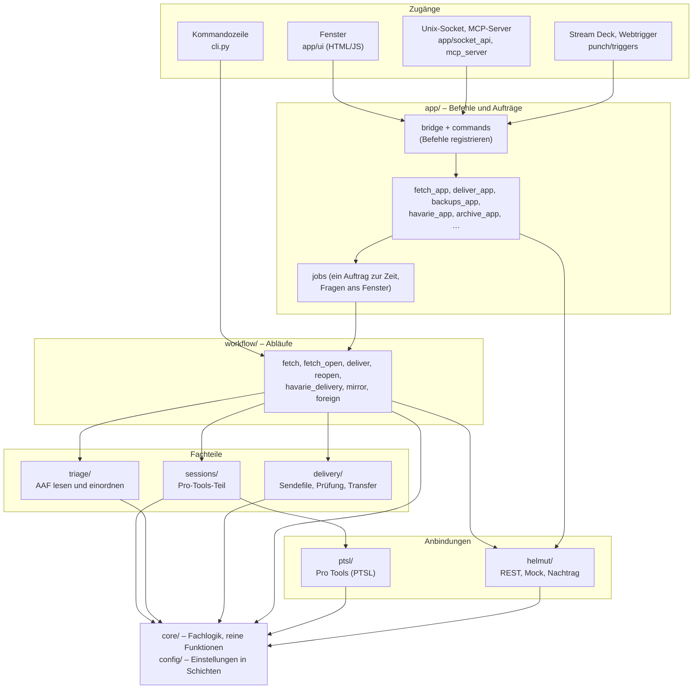

# Ottilie – Aufbau des Codes

Stand 13.10.2026. Diese Beschreibung ist für alle, die den Code lesen oder prüfen wollen. Sie erklärt, wie die Teile
zusammenspielen, wo was steht und welche Regeln der Code einhält. Bedienung und Abläufe aus Sicht der Mischer stehen in
der Oberfläche selbst; Verteilung und Bau in `docs/VERTEILUNG.md`, `docs/BAU_APPLE_SILICON.md` und `docs/MDM.md`; die
Schnittstelle der App in `docs/API.md` (aus dem Code erzeugt); die Anbindung an Helmut in
`docs/Ottilie_an_Helmut.html`.

## Worum es geht

Ottilie ist eine macOS-App für die Tonmischung in einem Sender. Sie holt Beiträge, die der Schnitt in **Helmut**
(Medien-Workflow-System von MoovIT) übergeben hat, legt in **Pro Tools** eine Session aus einem Template an,
importiert das AAF – auf Wunsch mit einer Triage, die jeden Clip als O-Ton, Atmo oder Musik einordnet und auf die
Zielspuren verteilt – und liefert die fertige Mischung als WAV-Dateien zurück an Helmut (Lautheit nach EBU R 128).
Fällt Helmut aus, arbeitet Ottilie im **Havariebetrieb**: Sie holt ein Übergabepaket direkt vom Speicher, baut das
Sendefile (ARD-ZDF-Profile, MXF mit 16 Monospuren) selbst, prüft es und liefert es aus; was Helmut hätte erfahren
müssen, wird nachgetragen. Dazu kommen die Aufnahme- und Exportfunktionen des Vorgängers **PunchBuddy** (Punch-In,
Transport, Exporte, Stream Deck, Webtrigger), die als Submodul eingebunden sind.

Code-Name ist `tonmischung` (Python-Paket, `python3 -m tonmischung`); alles, was Nutzer sehen, heißt Ottilie.

## Schnell ausprobieren

```
git clone --recurse-submodules <Repository>
cd <Repository>
python3 -m venv .venv && .venv/bin/pip install -r tools/requirements-bau.txt
.venv/bin/python -m pytest -q                    # Unit-Tests: ohne Pro Tools, ohne Netz (knapp 800)
.venv/bin/python -m tonmischung --help           # Kommandozeile
.venv/bin/python -m tonmischung app --mock       # App mit eingebautem Helmut-Mock (macOS, PyObjC)
```

Die Oberfläche lässt sich ohne App im Browser ansehen: `python3 -m http.server 8731 --directory tonmischung/app/ui`,
dann `http://localhost:8731` – ohne Gegenstelle antwortet `ui/demo.js` mit Beispieldaten.

Python 3.14, macOS 26. Tests, die echte Geräte oder Dateien brauchen, laufen nur auf Wunsch (siehe „Tests“).

## Schichten



Die Pfeile zeigen, wer wen aufruft. `core/` und `config/` hängen von nichts darüber ab; `ptsl/` und `helmut/` kennen
nur ihr Gegenüber und `core/`. Nebenläufigkeit gibt es nur in `app/` (Aufträge im Hintergrund, Takte für Raumstatus,
Spiegeln, fremde Dateien) und in `punch/triggers` (HTTP- und Socket-Server).

## Wo was steht

| Ordner | Inhalt | Einstieg |
|---|---|---|
| `tonmischung/core/` | Fachlogik ohne Pro Tools und Helmut: Zustände der Mischung (`mixstate`), Session-Regeln, Timecode, Namen, Spurprofile, Templates, Nutzer, Räume, Nachtrag-Warteschlange, sicheres Lesen und Schreiben eigener Dateien (`fileio`) | `mixstate.py`, `session_rules.py`, `fileio.py` |
| `tonmischung/config/` | Einstellungen in Schichten, Schema (`einstellungen.schema.json`), Schlüsselbund, Doku für die Geräteverwaltung | `settings.py` |
| `tonmischung/ptsl/` | Dünne Schicht über `py-ptsl`: ein Aufrufweg mit Zeitlimit, Sperre, Protokoll, verständlichen Fehlern; offene Pro-Tools-Dialoge erkennen | `client.py`, `dialogs.py` |
| `tonmischung/helmut/` | HTTP-Client (nur Standardbibliothek), Übersetzung Helmut-JSON ↔ Objekte (`mapping`), Übernehmen/Freigeben/Ausliefern mit Konfliktprüfung (`service`), Nachtragen, Mock-Server | `service.py`, `client.py`, `mapping.py` |
| `tonmischung/triage/` | AAF prüfen und lesen, jeden Clip einordnen (Spurname, Quellname, Signal), auf Zielspuren verteilen | `analyse.py`, `decide.py`, `placement.py` |
| `tonmischung/sessions/` | Pro-Tools-Teil: Import-Plan ausführen, Export (kürzen, konsolidieren, R 128, WAV je Spur), Triage-Verteilung in Pro Tools | `pt_export.py` |
| `tonmischung/delivery/` | Havarie-Sendefile: Bild umpacken oder neu kodieren, Ton einmuxen (ffmpeg, bmx), Format- und MXF-Prüfung, Prüfsumme, Bericht, Transfer | `mux.py`, `qc.py`, `transfer.py` |
| `tonmischung/workflow/` | Abläufe aus allem darunter: Holen, in offene Session holen, Zurückliefern, Stand öffnen, Havarie-Auslieferung, Spiegeln, fremde Dateien | `fetch.py`, `deliver.py` |
| `tonmischung/app/` | Mac-App: Fenster (WKWebView), Menüleiste, Befehle je Thema (`*_app.py`), Aufträge, Viewmodel, API-Katalog, Raumstatus (Helmut und Bonjour) | `main.py`, `commands.py`, `jobs.py` |
| `tonmischung/app/ui/` | Oberfläche: `index.html`, `app.js` (ohne Framework), Stylesheets mit Farbrollen und fünf Farbschemata | `app.js` |
| `tonmischung/punch/` | PunchBuddy-Funktionen in Ottilie: Kern über dieselbe PTSL-Verbindung, Befehle, Webtrigger, Stream-Deck-Starter | `core.py`, `commands.py` |
| `tonmischung/` (oben) | Kommandozeile, MCP-Server, `factory` (Clients und Werte aus den Einstellungen), Pfade, Selbsttest, Diagnose, Watchdog | `cli.py`, `factory.py` |
| `vendor/` | `punchbuddy` (Git-Submodul, nur lesen), `hedwig` (übernommene Module zur AAF-Erkennung) | `tonmischung/vendor.py` |
| `tools/` | Bau: Werkzeuge bündeln, PyInstaller, Universal-Paket, DMG, feste Paketversionen | `build_app.sh`, `build_dmg.sh` |
| `tests/` | Unit-Tests mit Fakes (`FakeEngine` für Pro Tools, `MockHelmut`), dazu Tests gegen echte Geräte auf Wunsch | `fakes.py`, `conftest.py` |

## Abläufe

### Holen (`workflow/fetch.py`, im Fenster `app/fetch_app.py`)

1. **Prüfen, ohne etwas zu ändern** (`load_handover`): Beitrag aus Helmut lesen, darf er übernommen werden
   (`mixstate.check_take`), Übergabe mit AAF, AAF lesbar und nicht abgeschnitten (`triage/aafcheck`).
2. **Offene Session** (`plan_for_open_session` → `core/session_rules.decide_before_import`): Gehört sie zu einem
   ausgelieferten Beitrag, wird sie gespeichert und geschlossen; sonst fragt Ottilie (`NeedsConfirmation`, im Fenster
   als Frage, `app/shared.confirming`).
3. **Triage** (wenn eingeschaltet): jeden Clip einordnen; Medien prüfen (fehlender Ton vorher sagen); andere Bildrate
   oder Sequenzbeginn umrechnen.
4. **In Helmut übernehmen** (`helmut/service.take`): sperren, Set „Mischung“ schreiben – erst jetzt, wenn alle
   Prüfungen bestanden sind.
5. **Pro Tools**: offene Session speichern und schließen, Session aus Template im Ablageort anlegen, Sessionbeginn
   prüfen (sonst stürzt Pro Tools beim Import ab), AAF importieren (Match Tracks; mit Triage auf die Zielspuren,
   danach Bereiche verschieben), Referenzvideo, **jeden Clip nachprüfen** (die Antwort des Imports ist unzuverlässig),
   Spuransicht, zum Programmbeginn, speichern.
6. **Helmut**: Zustand „importiert“ mit Session-Pfad. Ist Helmut nicht erreichbar, kommt die Änderung in die
   Nachtrag-Warteschlange.

„In offene Session holen“ (`workflow/fetch_open.py`) teilt die Bausteine 1–3 und den Import mit dem Holen
(`load_handover`, `at_session_rate`, `confirm_missing_media`, `decide_missing_tracks`, `mapped_names`).

### Zurückliefern (`workflow/deliver.py`, `app/deliver_app.py`)

Richtige Session offen? Sonst nach den Session-Regeln wechseln. Dann der Pro-Tools-Teil (`sessions/pt_export`):
Transport stoppen, speichern, Überhänge kürzen, alle Exportspuren über die Videolänge konsolidieren (leere werden
digitale Null), Lautheit korrigieren (24 bit / 48 kHz, True Peak begrenzt), WAVs nach `<Session>/export/`. Danach
die WAVs in den Übergabeordner kopieren (nie überschreiben), je WAV ein Asset in Helmut, Zustand „ausgeliefert“,
Projekt entsperren. Wer ausgeliefert hat, darf erneut zurückliefern, solange niemand anders übernommen hat
(`mixstate.may_deliver`).

### Havarie (`app/havarie_app.py`, `workflow/havarie_delivery.py`, `helmut/offline.py`)

„Paket manuell öffnen“ holt wie oben, nur mit `OfflineService` statt Helmut: Übernahme und Zustände werden mit einer
Havarie-Kennung in die Warteschlange geschrieben und später einem Helmut-Beitrag zugeordnet. „Sendefile erstellen“
exportiert wie beim Zurückliefern, sucht das Bild neben dem AAF, baut das Sendefile nach Preset (`delivery/mux`:
umpacken oder neu kodieren, Halbbildreihenfolge ausdrücklich, Startband, Kanäle nach der Spurtabelle, bmx-Nachlauf),
prüft es (`delivery/qc`, `mxf_structure`), schreibt Prüfsumme und Bericht und überträgt es an lokale Ziele.

### Nachtrag (`core/catchup.py`, `helmut/catchup.py`, `app/catchup_app.py`)

Jede Schreibänderung an Helmut, die wegen eines Ausfalls nicht ankam, steht als Eintrag in einer JSON-Datei. Alle
60 s und auf Knopfdruck wird in Reihenfolge nachgetragen. Vorher wird geprüft, ob der Beitrag noch demselben Mischer
im selben Raum gehört; sonst wird nichts überschrieben, der Eintrag wird ein Konflikt, und der Mischer kann ihn
verwerfen.

## Fenster, Aufträge und Schnittstelle

- **Bridge** (`app/bridge.py`): Das Fenster schickt Befehle als JSON, bekommt Antworten und Ereignisse zurück.
  `app/commands.register_all` meldet alle Befehle an; je Thema registriert ein `*_app.py`-Modul seine eigenen.
- **Aufträge** (`app/jobs.py`): Alles, was Pro Tools benutzt, läuft als Auftrag im Hintergrund – immer nur einer, weil
  Pro Tools nur eine Session offen hat. Fortschritt und Fragen gehen als Ereignis „job“ ans Fenster; der Auftrag
  wartet auf die Antwort. Wächter verhindern Befehle während eines Auftrags (`NOT_DURING_JOB`) und ohne angemeldeten
  Nutzer (`USER_REQUIRED`).
- **Viewmodel** (`app/viewmodel.py`): reine Funktionen von Kerndaten auf das, was das Fenster zeigt.
- **API-Katalog** (`app/api.py`): die öffentlichen Befehle mit Argumenten, Ergebnis und Rechtestufe (lesen, ändern,
  verwalten). Der Unix-Socket und der MCP-Server für KI-Assistenten gehen darüber; `docs/API.md` wird daraus erzeugt
  (ein Test prüft, dass sie aktuell ist).
- **Oberfläche** (`app/ui/`): `app.js` baut die Ansichten als Text, `render(quiet)` ersetzt nur geänderte Bereiche,
  Ansagen für VoiceOver laufen über eine Live-Region, Fokus wird nach jeder Änderung wiederhergestellt. Farben nur
  über Rollen (`themes.css`); Tests prüfen, dass jedes Schema jede Rolle setzt und die Kontraste nach WCAG reichen.

## Einstellungen

`config/settings.py` liest in dieser Rangfolge: **Geräteverwaltung** (Konfigurationsprofil, verwaltet, gesperrt) >
**Spurprofil** des Templates der offenen Session > **Nutzer** > **zentral** > **lokal** > **Hausstandard** aus dem
Schema. Das Schema (`config/einstellungen.schema.json`) beschreibt jedes Feld mit Vorgabe, Quelle (`x-quelle`) und
Beschriftung; das Einstellungsfenster entsteht daraus (`app/settings_view.py`). Felder mit `x-ab` sind vorbereitet,
wirken aber noch nicht und sind ausgeblendet – ein Test sorgt dafür, dass Code keine ausgeblendete Einstellung liest.
Zugangsdaten stehen nie in Einstellungen, nur im macOS-Schlüsselbund (`config/keychain.py`).

## Regeln, die der Code durchsetzt

- **Nichts überschreiben, nichts löschen.** Eigene Dateien werden atomar geschrieben (`core/fileio.write_json`), neue
  Dateien nur unter freiem Namen (`write_new`, `publish_new`). Beschädigte Dateien werden beiseitegelegt, nicht
  überschrieben. Ausnahme: Die Lautheitskorrektur ersetzt die beim Export konsolidierte WAV in der Session.
- **Vor jedem Schließen speichern**, scheitert das Speichern, wird nichts geschlossen und nichts importiert
  (`core/session_rules`, `sessions/runner`).
- **Jeder PTSL-Aufruf hat ein Zeitlimit**, läuft über eine Sperre und meldet offene Pro-Tools-Dialoge mit Namen
  (`ptsl/client.call`, `ptsl/dialogs`). Interne Pro-Tools-Fehler (Assertions) werden im Pro-Tools-Protokoll erkannt
  und halten weitere Befehle an.
- **Helmut: erst frisch lesen, dann schreiben.** Gehört der Beitrag inzwischen jemand anderem, wird nichts
  überschrieben (`helmut/service`, `mixstate.owned_by`).
- **Im Entwicklungsmodus nur im Testordner** (`AppContext.safe_root`): Mit `--mock` legt Ottilie Sessions nur dort an.
- **Gleiche Session erkennen** über `core/session_rules.same_session` (Umlaute kommen mal zerlegt, mal zusammengesetzt).

## Fremdcode

| Teil | Wo | Wozu |
|---|---|---|
| PunchBuddy | `vendor/punchbuddy` (Git-Submodul), Zugriff nur über `tonmischung/vendor.py` | Punch-In, Transport, Exporte, Lautheitskorrektur, Vocaster |
| Hedwig | `vendor/hedwig` (Kopie; Kommentare angepasst) | AAF-Essenz lesen, Signal einordnen (Sprache, Atmo, Musik) |
| py-ptsl, pyaaf2, numpy, scipy, soundfile, pyloudnorm, PyObjC, rumps | `tools/requirements-bau.txt` (feste Versionen) | PTSL, AAF, Signal, Lautheit, Mac-Oberfläche |
| ffmpeg, ffprobe, mediainfo, bmx | im App-Paket mitgeliefert (`tools/bundle_tools.py`), Lizenzen in `docs/LIZENZEN.md` | Sendefile bauen und prüfen |

## Tests

```
python3 -m pytest -q                                   # alles ohne Geräte und Netz
TONMISCHUNG_PTSL_TESTS=1 python3 -m pytest -q tests/test_ptsl_integration.py   # gegen das laufende Pro Tools
TONMISCHUNG_AAF_TESTS=1 python3 -m pytest -q tests/test_triage_analyse.py      # echte AAFs (lange)
TONMISCHUNG_UI_TESTS=1 python3 -m pytest -q tests/test_app_bridge.py           # echtes Fenster (Selbsttest)
```

- `tests/fakes.py`: `FakeEngine` spielt Pro Tools nach (Spuren, Clips, Konsolidieren, Fehler auf Wunsch);
  `helmut/mock.py` ist ein HTTP-Server im Format der Helmut-OpenAPI und lehnt falsch geformte Anfragen ab.
- Echte Testdateien (AAFs, Videos) sind nicht im Repository. Wo Tests sie brauchen, stehen die Pfade je Mac in
  `testfiles/entwicklung.json` (Vorlage `tools/entwicklung.beispiel.json`, gelesen von `tonmischung/devlocal.py`);
  fehlen sie, werden diese Tests übersprungen.
- Wächtertests prüfen u. a.: Doku aktuell (`docs/API.md`, `docs/MDM.md`), Paketliste aktuell, keine ausgeblendete
  Einstellung wird gelesen, jedes Farbschema vollständig und kontrastreich, keine alten Namen in sichtbaren Texten.

## Konventionen

- Oberfläche, Meldungen, Kommentare und Doku auf Deutsch; Bezeichner, Funktions- und Modulnamen auf Englisch.
- Reine Logik ohne Ein- und Ausgabe, wo es geht (`core/`, `viewmodel`, `settings_view`, `triage/decide`), damit sie
  ohne Geräte testbar ist; Ein- und Ausgabe am Rand.
- `# ANNAHME:` markiert, was am echten System noch zu prüfen ist (vor allem Helmut-Formate).
- Kommentare wie „Jens 09.10.2026: …“ nennen die fachliche Vorgabe hinter einer Entscheidung; „Review 09.10.2026, B12“
  verweist auf eine frühere Code-Durchsicht.
- Verweise wie „Funktionsbeschreibung S. 27“, „Plan Triage“, „Prototyp“ oder „PunchBuddy §10“ beziehen sich auf die
  fachliche Beschreibung, die Umsetzungspläne, den klickbaren Prototyp der Oberfläche und die Betriebserfahrungen mit
  PunchBuddy. Diese Unterlagen liegen nicht im Repository; der Kommentar nennt jeweils, was daraus folgt.
- Commits auf Deutsch mit Präfix (`feat:`, `fix:`, `refactor:`, `docs:`, `test:`, `chore:`); jeder Commit lauffähig.
- `flake8 --max-line-length 120` ohne Befund für `tonmischung/`.

## Grenzen und offene Punkte

- Gegen die echte Helmut-Instanz ist noch nichts geprüft – nur gegen den Mock nach der offiziellen OpenAPI. Welche
  Annahmen dort zu klären sind, steht in `docs/Ottilie_an_Helmut.html`.
- PTSL kann kein Clip Gain, kein Umverknüpfen, kein „Kopie speichern unter“, keine Template-Liste und keine
  Voreinstellungen; der AAF-Import ordnet nur nach Namen zu. Ottilie umgeht das, wo es geht (Umbenennen vor dem
  Import, Templates aus dem Template-Ordner, Prüfung jedes Clips danach).
- Vorbereitet, aber nicht angebunden: FTP/FTPS/SFTP-Ziele der Havarie, Auslösung ohne Rückfrage (Countdown), die
  Verarbeitung durch Helmut (Streams, Jobs), zentrale Einstellungen in Helmut; im Schema als „noch ohne Funktion“
  ausgeblendet.
- Signatur und Notarisierung mit einem festen Zertifikat fehlen; das Paket ist ad hoc signiert.
