# Ottilie – Bedienungsanleitung

Stand: 13.11.2026 · Ottilie 0.3 · Ottilie-Zentrale 0.2

Ottilie holt übergebene Beiträge in Pro Tools, liefert die Mischung zurück und zeigt, was in den anderen
Räumen los ist. Sie arbeitet mit der **Ottilie-Zentrale**. Die Zentrale verbindet die Räume: Raumstatus, Chat, Belegen
und gemeinsame Einstellungen. Raum und Betriebsart jedes Macs legt die Administration der Zentrale fest. Fällt die
Verbindung aus, arbeitet Ottilie mit dem zuletzt bekannten Raum weiter, nur ohne Raumstatus, Chat und Belegen über
die Zentrale.

Die Anleitung hat drei Teile:

- [Teil A – Ottilie am Mischplatz](#teil-a--ottilie-am-mischplatz) (Tonmischung, Mac mit Pro Tools)
- [Teil B – Web-App der Zentrale](#teil-b--web-app-der-zentrale) (Schnitträume und andere Plätze ohne Ottilie)
- [Teil C – Administration der Zentrale](#teil-c--administration-der-zentrale) (Technik)

Die Bilder zeigen Beispieldaten. Namen, Titel und Pfade sind erfunden.

**Zwei Betriebsarten.** Ottilie arbeitet entweder mit der **Helmut-API** (Beiträge, Sperre und Zustand kommen aus
Helmut) oder mit dem **Übergabeordner** (der Schnitt legt Filmordner auf einem Speicher ab). Welche gilt, gibt die
Zentrale vor; die Titelleiste zeigt sie. Wo sich etwas unterscheidet, steht es dabei.

**Was heißt was**

| Begriff | Wer | Bedeutung |
|---|---|---|
| **Holen** | Mischraum | Beitrag übernehmen, belegen und in Pro Tools importieren |
| **belegt** | – | Ein Mischraum hat den Beitrag. Andere Räume können ihn nicht holen. |
| **Zurückliefern** | Mischraum | Fertige Mischung als WAVs abgeben |
| **Freigeben** | Mischraum | Eigenen Beitrag ohne Lieferung abgeben (z. B. Raumwechsel) |
| **Beitrag zurückgeben** | Mischraum | Beitrag eines *anderen* Raums freigeben (Ansicht *Räume*) |
| **Lösen** | Administration | Belegung in der Zentrale aufheben |
| **Zuordnen** | Administration | Einen wartenden Mac einem Raum zuweisen (Anmelden ohne Code) |
| **Umziehen** | Administration | Einen Mac einem anderen Raum zuweisen |
| **Verwerfen** | Mischraum | Einen Eintrag im Nachtrag nicht mehr nachtragen |

---

## Teil A – Ottilie am Mischplatz

**Kurzablauf:**
1. Beitrag in der Liste wählen → **Holen** ([A3](#a3-beitrag-holen)).
2. In Pro Tools mischen und speichern ([A4](#a4-mischen)).
3. **Zurückliefern …** ([A5](#a5-zurückliefern)).

### A1. Das Hauptfenster

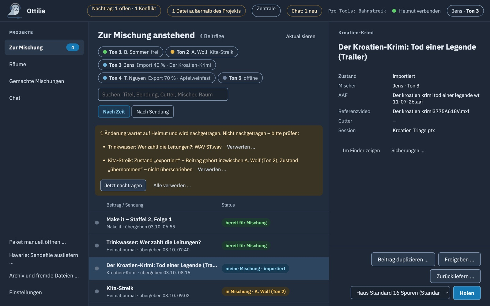

**Titelleiste** (von links nach rechts, nur wenn es etwas zu melden gibt):

| Anzeige | Bedeutung |
|---|---|
| **Nachtrag: 1 offen · 1 Konflikt** | Änderungen, die noch nicht bei Helmut bzw. im Übergabeordner angekommen sind. Ottilie trägt sie selbst nach. Konflikte müssen Sie prüfen (siehe [A10](#a10-nachtrag)). |
| **1 Datei außerhalb des Projekts** | Die offene Session nutzt Audio außerhalb des Projektordners. Klick öffnet „Archiv und fremde Dateien“. |
| **Zentrale** | Verbunden mit der Ottilie-Zentrale. Gelb mit Text, wenn etwas fehlt, z. B. „Zentrale: Mac wartet auf Zuordnung – Administration anrufen und Code … nennen“. Klick öffnet *Einstellungen → System → Zentrale*. |
| **Chat: 1 neu** | Ungelesene Nachrichten. Klick springt ins Gespräch. |
| **Pro Tools: …** | Die gerade offene Session. |
| **Helmut verbunden** | Verbindung zu Helmut bzw. zum Übergabeordner. |
| **Jens · Ton 3** | Angemeldeter Nutzer und Raum dieses Macs. Klick: Nutzer wechseln. Steht dahinter „→ Ton 7 (nach dem Zurückliefern)“, führt die Zentrale den Mac unter neuem Namen (siehe [A7](#a7-räume)). |

**Links** die Ansichten: *Zur Mischung*, *Räume*, *Gemachte Mischungen*, *Chat* (nur wenn die Zentrale den Chat
eingeschaltet hat). Darunter die Sonderwege *Paket manuell öffnen*, *Havarie: Sendefile ausliefern*,
*Archiv und fremde Dateien* und die *Einstellungen*.

**Mitte** die Liste der Beiträge, die zur Mischung anstehen. Oben die Räume als Kurzübersicht, darunter Suche und
Sortierung *Nach Zeit* / *Nach Sendung*. ⌘R liest die Liste sofort neu ein.

Zustände in der Liste:

| Zustand | Bedeutung |
|---|---|
| **bereit für Mischung** | Kann geholt werden. |
| **meine Mischung · importiert** | Gehört Ihnen in diesem Raum. |
| **in Mischung · A. Wolf (Ton 2)** | Ein anderer Raum mischt. Holen ist gesperrt. |
| **wird übertragen** / **unvollständig** | Nur Übergabeordner: Der Schnitt kopiert noch bzw. es fehlen Dateien. |
| **neue Übergabe** | Der Schnitt hat eine neue Fassung abgelegt, während Sie mischen. |

**Mehrere Übergabeordner:** Unter dem Titel steht die Herkunft, z. B. „Ordner Schnitt Nord“. Fällt ein Ordner aus,
nennt ein gelber Hinweis über der Liste ihn. Seine Filme bleiben mit dem zuletzt gelesenen Stand und dem Zusatz
„nicht erreichbar“ in der Liste. Holen und Zurückliefern gehen dort erst wieder, wenn der Ordner zurück ist. Die
Filme aus den anderen Ordnern gehen weiter.

**Rechts** das Detail des gewählten Beitrags mit den Knöpfen *Holen*, *Zurückliefern …*, *Freigeben …*,
*Beitrag duplizieren …*, *Im Finder zeigen* und *Sicherungen …*.

### A2. Anmelden: Wer arbeitet hier?

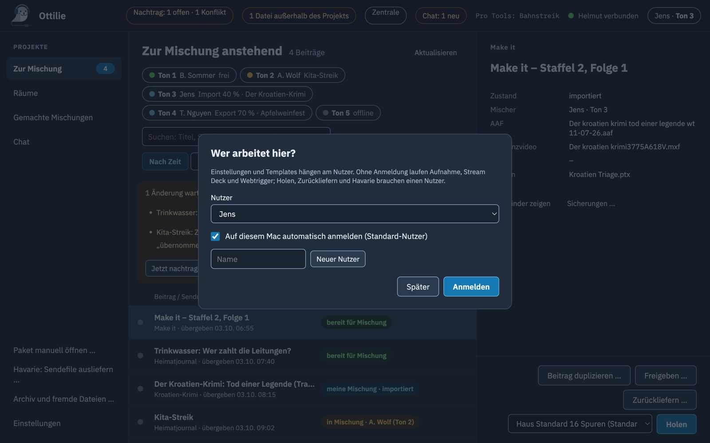

Einstellungen und Templates hängen am Nutzer, nicht am Mac. Beim Start fragt Ottilie, wer hier arbeitet. Mit dem
Haken *Auf diesem Mac automatisch anmelden* entfällt die Frage. Ohne Anmeldung laufen Aufnahme, Stream Deck und
Webtrigger weiter. Holen, Zurückliefern und Havarie brauchen einen Nutzer. Ein Kennwort gibt es nicht.

### A3. Beitrag holen

Beitrag in der Liste wählen, unten rechts das Template wählen und **Holen** klicken.

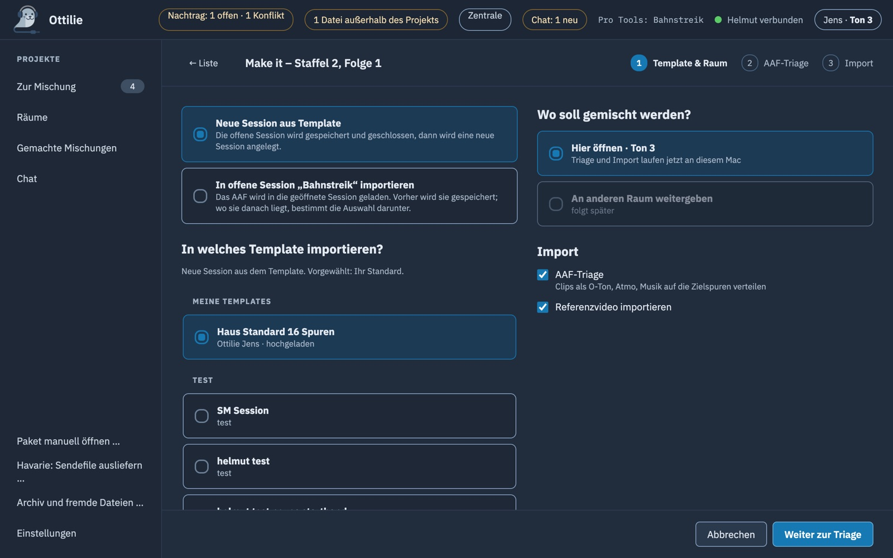

**Schritt 1 – Template & Raum**
- **Neue Session aus Template:** Die offene Session wird gespeichert und geschlossen, dann legt Ottilie eine neue
  Session an. Lässt sich die offene Session nicht speichern, schließt Ottilie nichts und importiert nichts.
- **In offene Session importieren:** Das AAF kommt in die geöffnete Session. Die Auswahl darunter bestimmt, wo
  die Session danach liegt.
- **Template:** Vorgewählt ist Ihr Standard (siehe [A12](#a12-einstellungen)).
- **Import:** *AAF-Triage* verteilt die Clips auf die Zielspuren (O-Ton A1–A4, Atmo A5–A10, Musik M1–M4, Rest ab
  A11). *Referenzvideo importieren* holt das Bild mit.

**Schritt 2 – AAF-Triage**, **Schritt 3 – Import:** Ottilie zeigt den Ablauf Schritt für Schritt.

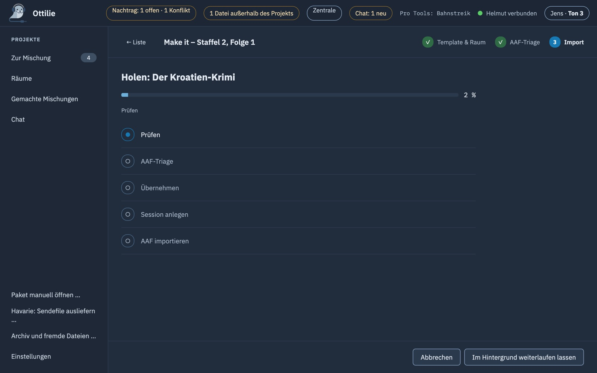

Mit *Im Hintergrund weiterlaufen lassen* kommen Sie zurück zur Liste. Der Auftrag läuft weiter und steht oben in der
Titelleiste. Am Ende ist die Session in Pro Tools geöffnet und der Beitrag für Sie belegt.

**Belegen:** Wollen zwei Räume denselben Beitrag fast gleichzeitig holen, bekommt ihn genau einer.
- *Helmut-API:* Helmut entscheidet. Der andere Raum sieht „bereits übernommen von …“.
- *Übergabeordner:* Die Zentrale entscheidet; ist sie nicht erreichbar, die Sperrdatei im Filmordner. Der andere
  Raum sieht „schon in Ton 1 belegt“.

### A4. Mischen

Gemischt wird ganz normal in Pro Tools. Ottilie läuft daneben:
- Holt die Session Audio von außerhalb des Projekts (z. B. aus „Downloads“), meldet die Titelleiste das. Unter
  **Archiv und fremde Dateien** kopiert Ottilie solche Dateien ins Projekt (`Audio Files/Extern`) und zeigt neue
  Dateien aus den Archiv-Ordnern der letzten 7 Tage. Diese lassen sich an der Einfügemarke importieren.

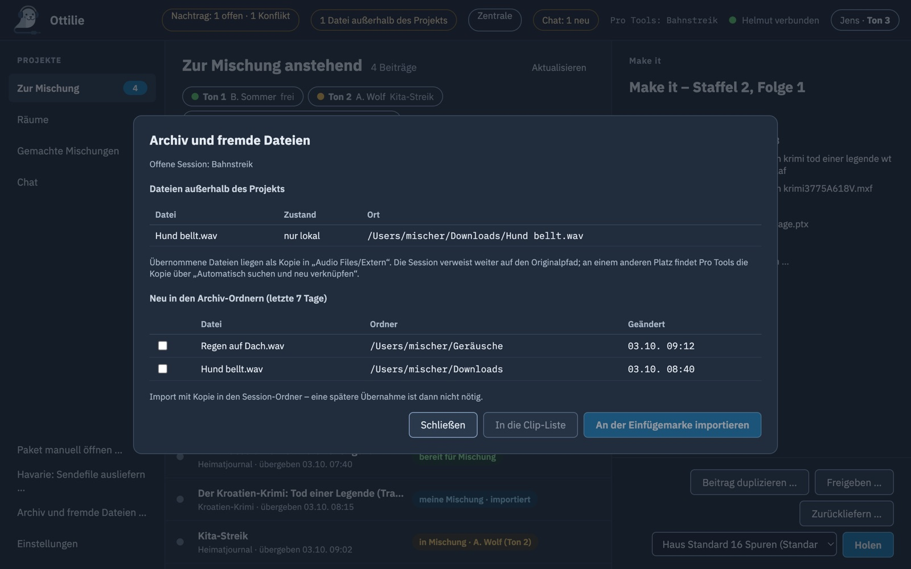

- In der Betriebsart *Übergabeordner* spiegelt Ottilie die Session auf Wunsch in den Beitragsordner
  (`Ton/ProTools`). Die Titelleiste zeigt „gespiegelt hh:mm“.

### A5. Zurückliefern

Beitrag wählen und **Zurückliefern …** klicken.

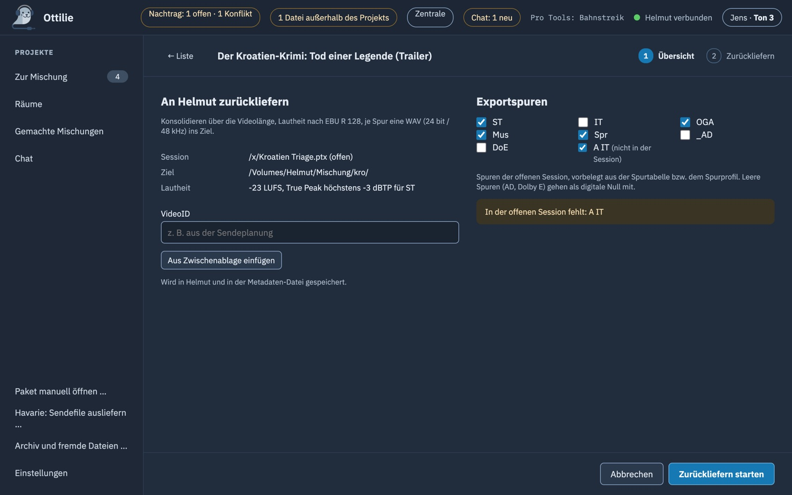

- Ottilie konsolidiert über die Videolänge und legt je Spur eine WAV (24 bit / 48 kHz) ins Ziel.
- **Lautheit:** Auf den Spuren, die in der Spurtabelle mit „R 128“ markiert sind (meist der Sendeton), misst und
  korrigiert Ottilie nach EBU R 128. Hausstandard: −23 LUFS, True Peak höchstens −3 dBTP.
- **Exportspuren:** Vorbelegt aus der Spurtabelle bzw. dem Spurprofil. Die Kürzel:
  - ST: Sendeton
  - IT: internationaler Ton
  - AD: Audiodeskription
  - DoE: Dolby E
  - OGA: O-Töne, Geräusche, Atmo
  - Mus: Musik
  - Spr: Sprache/Kommentar

  Leere Spuren (AD, Dolby E) gehen als digitale Null mit. Fehlt eine angehakte Spur in der Session, steht das gelb
  daneben. Dann vor dem Start prüfen, ob die Spur in Pro Tools anders heißt.
- **VideoID:** Aus der Sendeplanung, z. B. per *Aus Zwischenablage einfügen*. Sie wird in Helmut und in der
  Metadaten-Datei gespeichert.

**Zurückliefern starten** zeigt den Ablauf: Session vorbereiten, Kürzen und einblenden, Konsolidieren, Lautheit,
WAVs kopieren, Übergeben.

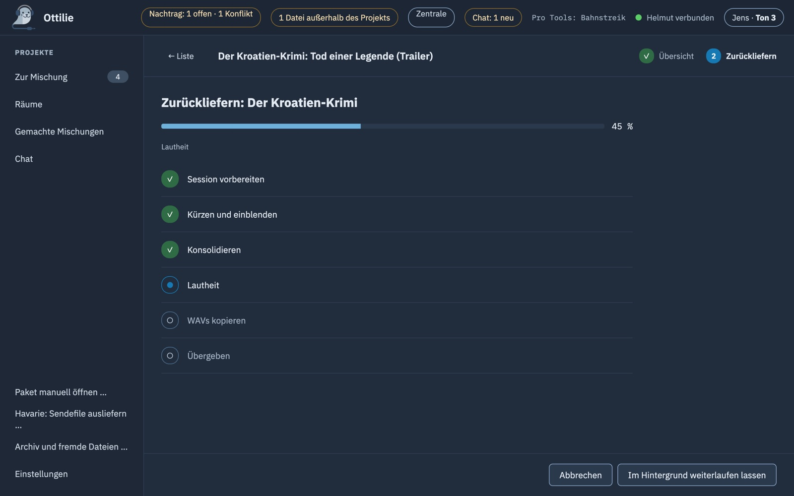

**Betriebsart Übergabeordner:**
- Die WAVs und `<ID>_metadaten.json` landen im Filmordner unter **Audio Export** (der Name ist einstellbar). Bei
  mehreren Übergabeordnern ist das immer der Ordner, aus dem der Film kam.
- Erneut liefern geht jederzeit. Die frühere Lieferung verschiebt Ottilie nach `Audio Export/_alt/<Zeit>/`. Ist
  „Erneute Lieferung: Zeitstempel“ eingestellt, liegt jede Lieferung gleich in einem eigenen Unterordner mit
  Zeit. Gelöscht wird nichts.
- Ist die Fertigmeldung eingeschaltet, meldet Ottilie die Lieferung an die eingestellte Adresse. Kommt die Meldung
  nicht an, wiederholt Ottilie sie über den Nachtrag.
- Hat der Schnitt inzwischen eine neue Fassung abgelegt, warnt Ottilie rot. Ohne den Haken „Ich habe geklärt …“
  startet die Lieferung nicht.

### A6. Freigeben, Duplizieren, Sicherungen

**Freigeben …** gibt einen Beitrag ab, ohne zu liefern, z. B. bei einem Raumwechsel. Der Beitrag steht danach
wieder unter „Zur Mischung“. Die Session bleibt liegen. Sie wählen, ob beim nächsten Holen der letzte
gespeicherte Stand geöffnet oder neu importiert wird. Der gespeicherte Stand wird immer als Kopie unter neuem Namen
geöffnet. *Benachrichtigen* gibt es nur mit der Helmut-API.

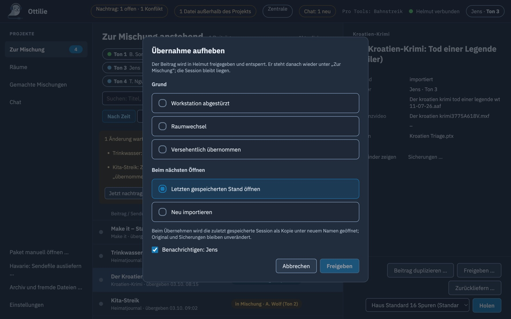

**Beitrag duplizieren …** legt einen neuen Beitrag mit derselben Übergabe an (Zweitfassung, Kurzfassung,
Web/Social, Ersatz). Mit *Mischstand übernehmen* startet das Duplikat mit einer Kopie der zuletzt gespeicherten
Session. Duplizieren geht nur mit der Helmut-API.

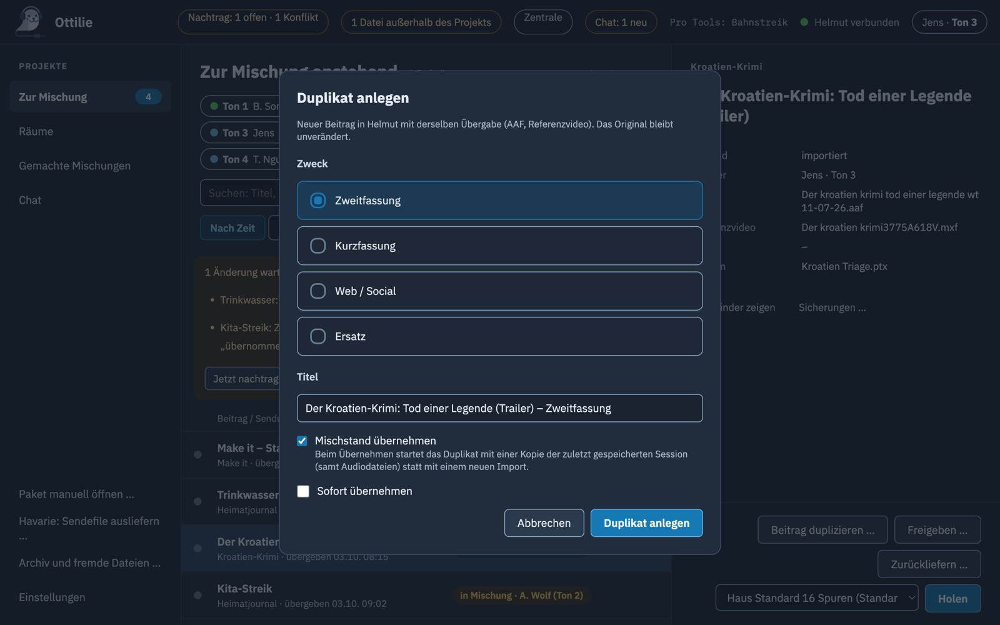

**Sicherungen …** listet die aktuelle Session und die Pro-Tools-Sicherungen. Öffnen legt immer eine Kopie
„…_wiederhergestellt_hhmm.ptx“ an. Original und Sicherungen bleiben unverändert.

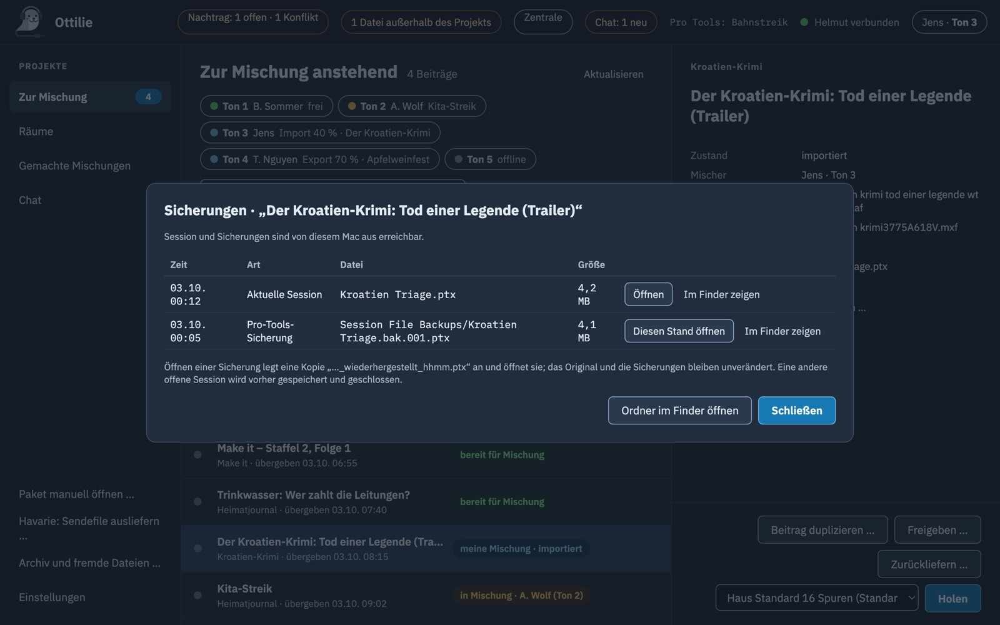

### A7. Räume

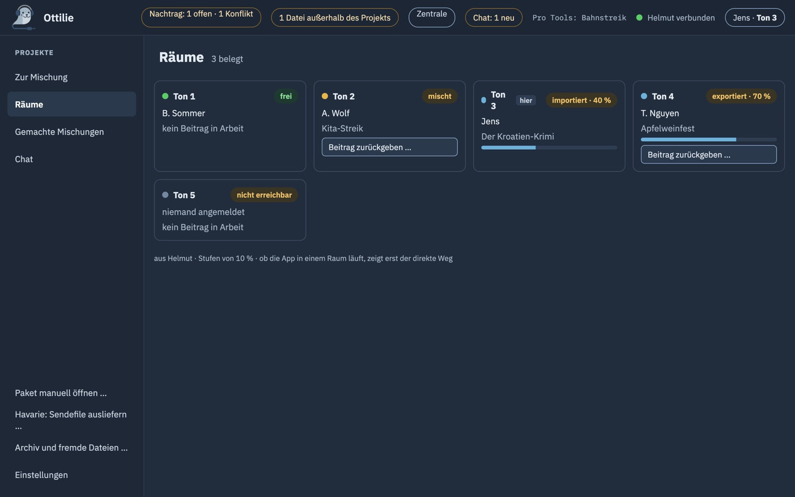

Je Raum eine Karte: Wer ist angemeldet, welcher Beitrag, welcher Schritt (z. B. „importiert · 40 %“), Fortschritt.
Welche Räume es gibt, legt die Administration der Zentrale fest. Schritt und Fortschritt kommen über die Zentrale,
die Belegung aus Helmut bzw. aus den Sperrdateien. Ohne Verbindung zur Zentrale zeigt die Ansicht nur, was Helmut
bzw. die Sperrdateien wissen. Unten steht die Quelle.

*Beitrag zurückgeben …* gibt einen Beitrag eines anderen Raums frei, z. B. wenn dort ein Mac abgestürzt ist. In der
Betriebsart Übergabeordner muss die Belegung zusätzlich in der Administration unter *Belegungen → Lösen* aufgehoben
werden ([C7](#c7-belegungen)). Sonst lehnt die Zentrale das Holen weiter ab.

**Raum dieses Macs.** Den Raum legt die Administration der Zentrale fest ([C3](#c3-räume--geräte)). In Ottilie
lässt er sich nicht ändern.

- Ohne Verbindung arbeitet Ottilie mit dem zuletzt bekannten Raum weiter. Er gilt für alle macOS-Benutzer des Macs.
  Raumstatus, Chat und Belegen über die Zentrale fehlen dann; die Titelleiste sagt es.
- Zieht die Administration den Mac in einen anderen Raum um oder benennt sie den Raum um, übernimmt Ottilie den
  neuen Namen erst, wenn auf diesem Mac nichts mehr in Arbeit ist: kein laufender Auftrag, kein übernommener Beitrag
  im Raum, kein offener Nachtrag, Helmut bzw. alle Übergabeordner erreichbar. Bis dahin zeigt die Titelleiste z. B.
  „Ton 3 → Ton 7 (nach dem Zurückliefern)“.

### A8. Gemachte Mischungen

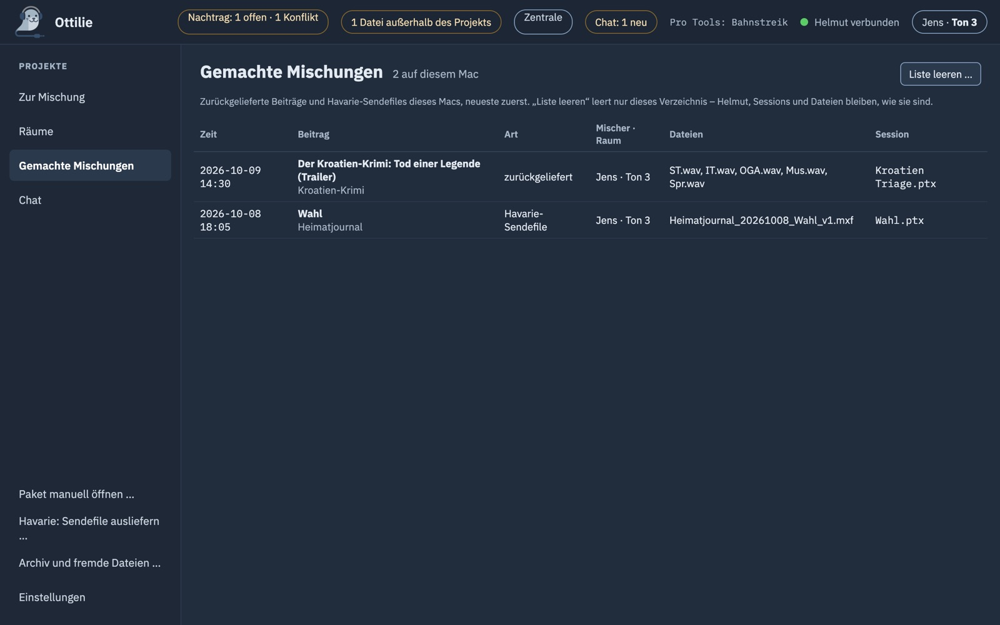

Zurückgelieferte Beiträge und Havarie-Sendefiles dieses Macs, neueste zuerst, mit Dateien und Session. Das
Verzeichnis gilt für alle macOS-Benutzer des Macs. *Liste leeren …* leert nur dieses Verzeichnis, für alle Benutzer.
Helmut, Sessions und Dateien bleiben, wie sie sind.

### A9. Chat

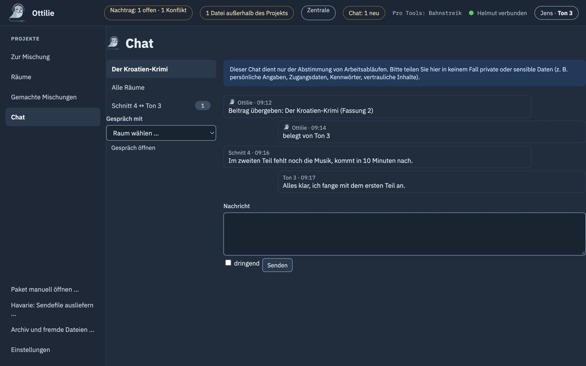

Den Chat gibt es nur, wenn die Administration ihn in der Zentrale eingeschaltet hat.

- **Gespräche:**
  - *Alle Räume*.
  - *Raum an Raum*: unter „Gespräch mit“ einen Raum wählen.
  - *Beitragsgespräch*: entsteht bei der Übergabe mit dem Schnittraum; beim Belegen kommt der Mischraum dazu.
    Nur in der Betriebsart Übergabeordner.
- **Systemmeldungen** (mit dem Ottilie-Logo) stehen im Beitragsgespräch, z. B. „übergeben“, „belegt von Ton 3“,
  „Audio Export fertig“.
- **Neue Nachrichten** meldet Ottilie als macOS-Mitteilung.
- **Dringend:** Haken vor dem Senden. In Ottilie steht der Text dann gleich in der Mitteilung, in der Web-App
  erscheint oben ein Hinweis. Ein Ton kommt nur, wenn die Zentrale das erlaubt, und in Ottilie nie während
  Aufnahme oder Wiedergabe.
- **Wichtig:** Der Chat dient nur der Abstimmung von Arbeitsabläufen, ohne private oder sensible Daten. Der Hinweis
  steht über jedem Gespräch.
- **Wo Nachrichten liegen:** In Ottilie nur im Arbeitsspeicher, nach einem Neustart ist der Verlauf weg. Auf der
  Zentrale liegt eine Nachricht nur, bis alle Zielräume sie empfangen haben, höchstens bis zur Haltezeit
  (Standard 24 h).
- **Absender** ist immer der Raum, nicht die Person.

### A10. Nachtrag

Ist Helmut oder der Übergabeordner kurz nicht erreichbar, merkt sich Ottilie die Änderung und trägt sie nach. Das
Hauptfenster zeigt dann einen gelben Kasten:

- **Jetzt nachtragen** versucht es sofort. Sonst probiert Ottilie es jede Minute selbst.
- **Konflikte** entstehen, wenn ein Beitrag inzwischen einem anderen Raum gehört. Ottilie überschreibt dann
  nichts. *Verwerfen …* entfernt den Eintrag; Helmut bleibt, wie es ist.

**Mehrere Benutzer am Mac.** Der Nachtrag gilt für alle macOS-Benutzer dieses Macs (gemeinsamer Datenordner
`/Users/Shared/Ottilie`). Einträge anderer Benutzer stehen mit „von Benutzer …“ im Kasten.

- Jede Minute trägt Ottilie nur die eigenen Einträge nach.
- **Jetzt nachtragen** nimmt auch die Einträge anderer Benutzer mit, aber nur, wenn Betriebsart und Fertigmeldung
  bei Ihnen genauso eingerichtet sind. Sonst wartet der Eintrag und nennt den Grund, z. B. „Fertigmeldung ist für
  diesen Benutzer anders eingerichtet – nachtragen kann …“. Dann diesen Benutzer bitten, sich am Mac anzumelden und
  nachzutragen.
- *Alle verwerfen …* nennt vorher die anderen Benutzer, deren Einträge mit verworfen werden.

### A11. Havarie

Nur für den Ausfall von Helmut. Im Normalbetrieb gehen die WAVs über „Zurückliefern“ an Helmut. Ist Helmut nur
kurz weg und die Sendung nicht in Gefahr, trägt der Nachtrag alles selbst nach. Ist Helmut zur Sendezeit nicht
wieder da, nehmen Sie die Havarie.

- **Paket manuell öffnen …**: AAF und Referenzvideo direkt aus dem Paketordner importieren. Übernahme und Zustand
  trägt Ottilie in Helmut nach, sobald Helmut wieder da ist. Die geöffneten Pakete gelten für alle macOS-Benutzer
  dieses Macs.

  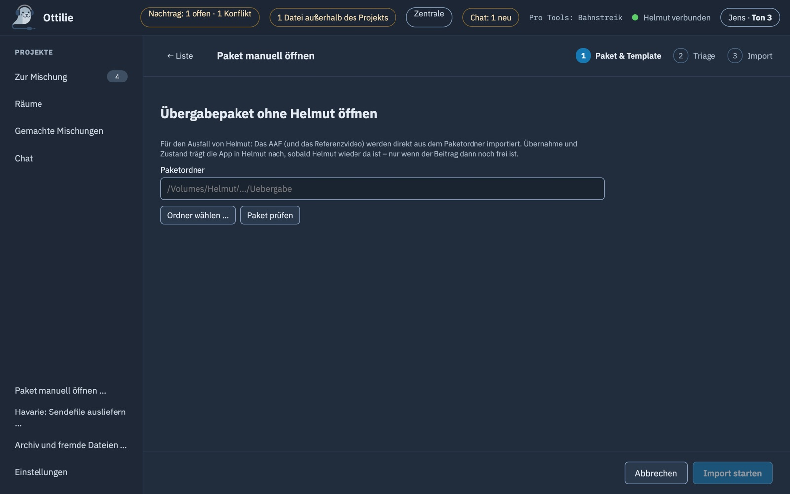

- **Havarie: Sendefile ausliefern …**: Ottilie baut selbst ein ARD-ZDF-konformes Sendefile (z. B. XDCAM HD422
  mit 16 Tonspuren) und liefert es an die Transfer-Ziele.

  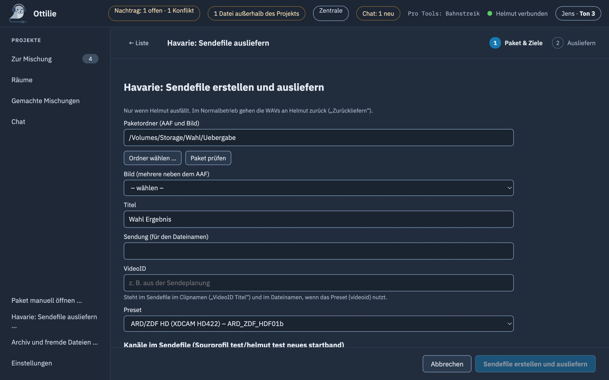

### A12. Einstellungen

Links die Bereiche *Persönlich*, *Aufnahme & Wiedergabe*, *Import*, *Export und Auslieferung*, *System*.
Änderungen gelten sofort. Unter jedem Wert steht seine **Herkunft**: Hausstandard, Nutzer, lokal geändert,
zentral (von der Zentrale), aus dem Spurprofil oder Geräteverwaltung (Konfigurationsprofil). Was die
Geräteverwaltung, die Zentrale oder ein Spurprofil vorgibt, ist gesperrt. Ändern lässt es sich nur dort.

| Abschnitt | Wofür |
|---|---|
| **Persönlich → Allgemein** | Meine Templates (hochladen, Standard festlegen), Farbschema |
| **Aufnahme & Wiedergabe** | Punch-In, Spur-Presets, Play Custom, Audio verschieben |
| **Import** | AAF-Triage, Zuordnungsregeln, Zielspuren, Spurprofile je Template, Timecode & Startband, Session-Ablage |
| **Export und Auslieferung** | Spurtabelle und Lautheit, Prüfung des Sendefiles, Notweg, Datei-Exporte |
| **System → Räume & Nutzer** | Raumname (nur ohne Anmeldung bei der Zentrale), gemeinsamer Datenordner, Nutzerliste, Ablage der Nutzer |
| **System → Übergabeordner** | Stand aller Übergabeordner, Betriebsart (von der Zentrale), Ordner, Netzadresse, Fertigmeldung |
| **System → Zentrale** | Adresse, Anmelden ohne Code, Kopplung, Code und Raum dieses Macs |
| **System → Stream Deck & Webtrigger, Focusrite Vocaster** | Fernsteuerung (Adressen, ID-Code dieses Macs) und Interface |
| **System → Über Ottilie** | Version, mitgelieferte Software und Lizenzen |

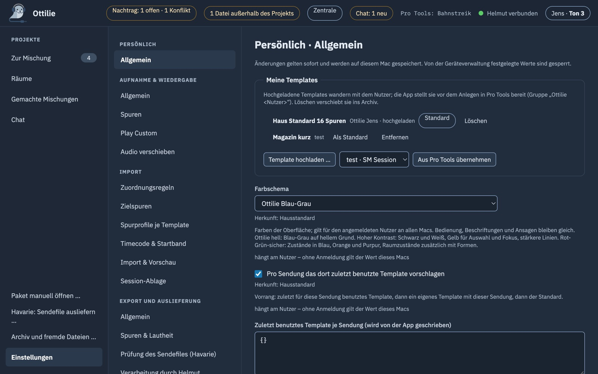

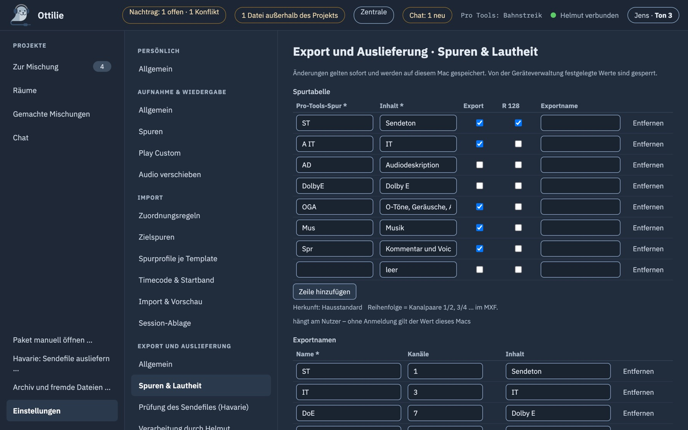

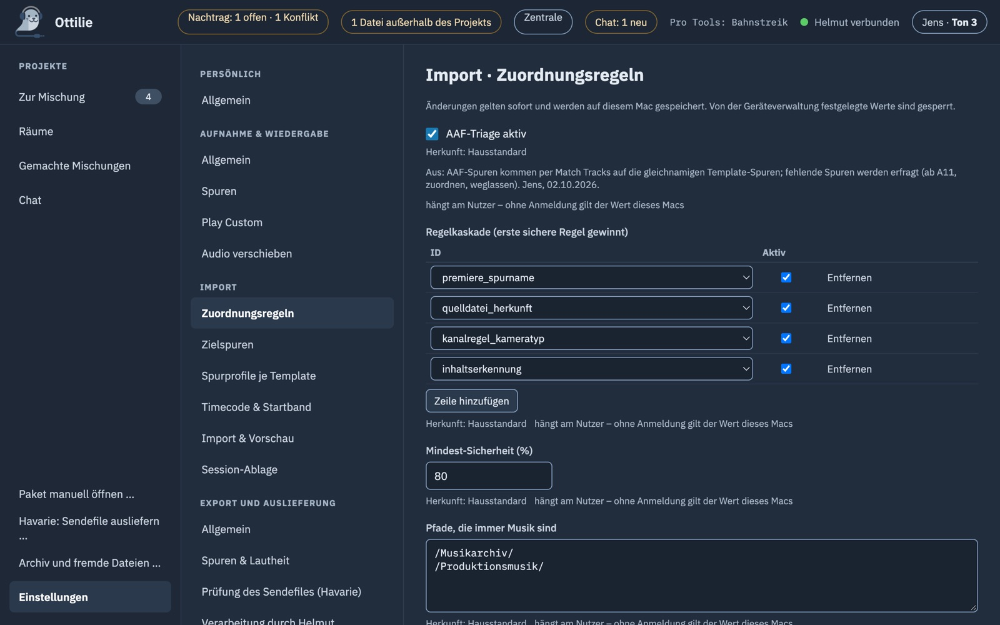

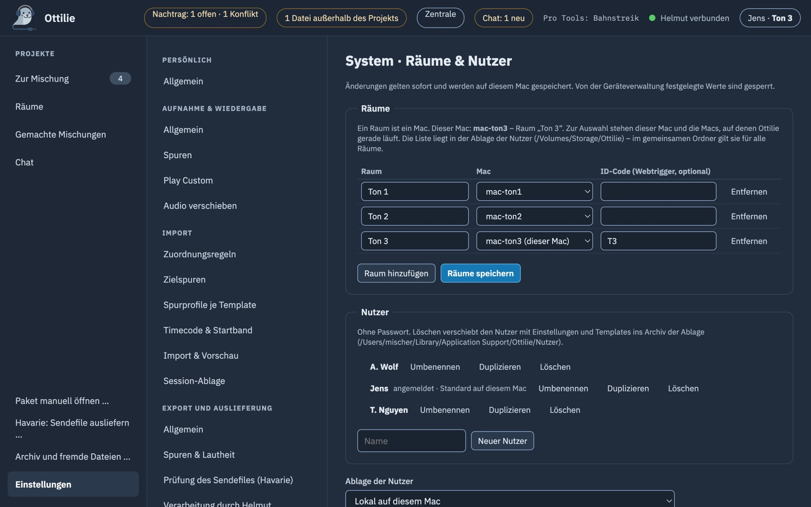

**Räume & Nutzer.** Eine Raumliste gibt es in Ottilie nicht mehr; den Raum legt die Zentrale fest.

- *Raumname dieses Macs* gilt nur, solange der Mac nicht bei der Zentrale angemeldet oder gekoppelt ist (leer: der
  Rechnername). Danach ist das Feld gesperrt.
- *Gemeinsamer Datenordner:* Nachtrag, Gemachte Mischungen und Havarie-Pakete liegen für alle macOS-Benutzer des
  Macs in `/Users/Shared/Ottilie`. Einen anderen Ort legt die Technik hier oder per Konfigurationsprofil fest, nicht
  über die Zentrale.
- Raumname und Webtrigger-ID-Code aus der früheren Raumliste übernimmt Ottilie beim ersten Start einmal. Den ID-Code
  gibt es jetzt einmal je Mac unter *System → Stream Deck & Webtrigger* (*ID-Code erzeugen*).

**Übergabeordner.** Oben steht der Stand: Betriebsart, ob der Ordner erreichbar und beschreibbar ist, wie viele
Filme bereit sind, wohin die Fertigmeldung geht. Mit *Testmeldung senden* prüfen Sie die Fertigmeldung.

- **Netzadresse** (`smb://Server/Freigabe/Ordner`): Ottilie bindet die Freigabe beim Start und vor dem Einlesen
  selbst ein. Die Anmeldung (Gast, Netzwerkanmeldung oder Schlüsselbund-Eintrag) richtet die Technik ein.
  Kennwörter stehen nie in den Einstellungen.
- **Betriebsart:** gibt die Zentrale vor (ohne Eintrag dort: Helmut-API). In Ottilie ist sie gesperrt. Ändert die
  Administration sie, übernimmt Ottilie sie erst, wenn kein Auftrag läuft, kein Film übernommen ist und der Nachtrag
  leer ist.
- **Mehrere Übergabeordner** legt die Administration fest ([C4](#c4-übergabeordner)). Unter *Alle Übergabeordner*
  steht jeder Ordner mit Netzadresse bzw. Pfad und Stand, z. B. „erreichbar, 3 Filme“. Ottilie bindet jede Freigabe
  selbst ein.

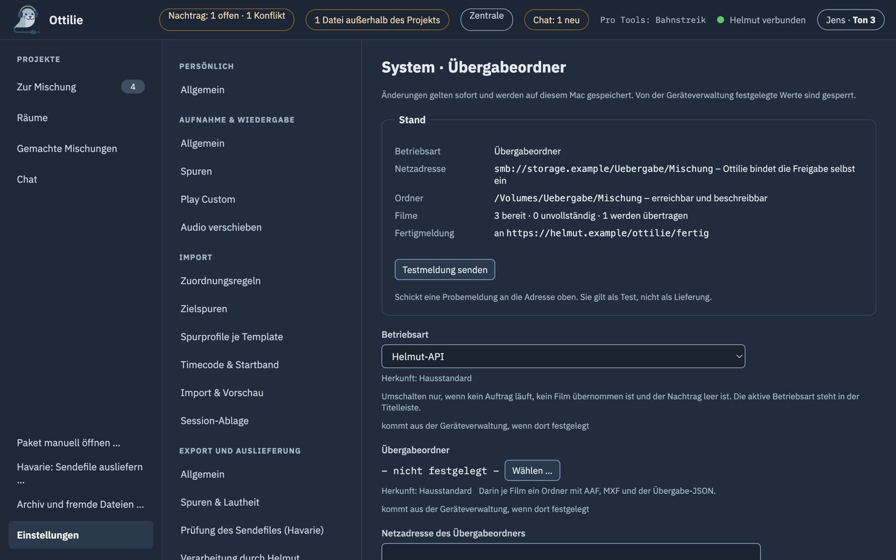

**Zentrale.** Oben stehen der Stand der Verbindung, die Anmeldung, der **Code dieses Macs** (6 Zeichen) und der
**Raum dieses Macs**.

So melden Sie einen neuen Mac an (ohne Code):

1. Unten unter *Adresse der Zentrale* die Adresse eintragen, falls sie nicht schon per Konfigurationsprofil
   vorgegeben ist, z. B. `https://server:8443`.
2. **Ohne Code anmelden …** klicken. macOS fragt einmal nach Name und Kennwort eines **Administrators**. Danach gilt
   die Anmeldung für alle Benutzer dieses Macs.
3. Ottilie zeigt den **Code dieses Macs**. Administration anrufen und den Code nennen.
4. Die Administration vergleicht den Code unter *Räume & Geräte → Wartende Geräte* und ordnet den Mac einem Raum zu
   (siehe [C3](#c3-räume--geräte)). Ottilie verbindet sich dann selbst neu und übernimmt den Raum.

Bis zur Zuordnung sieht und sendet der Mac nichts: kein Raumstatus, kein Chat, kein Belegen, keine Vorgaben. Lehnt
die Administration ab oder verfällt die Anfrage, bietet Ottilie **Neu anmelden …** an.

Zweiter Weg, mit Kopplungscode (Adresse wie oben):

1. In der Administration einen Kopplungscode für den Raum erzeugen lassen (siehe [C3](#c3-räume--geräte)).
2. Den Code unter *Kopplungscode* eingeben und **Koppeln …** klicken.
3. macOS fragt einmal nach einem Administrator. Der Mac gehört sofort zum Raum.

Weitere Hinweise:

- Den Raum übernimmt Ottilie aus der Zentrale. Zu Umziehen und Umbenennen siehe [A7](#a7-räume).
- **Neu verbinden** baut die Verbindung sofort neu auf.
- *Zentral vorgegeben* listet die Werte, die gerade von der Zentrale kommen.
- Erscheint eine Schlüsselbund-Abfrage, die Sie nicht selbst ausgelöst haben: ablehnen und Technik fragen.

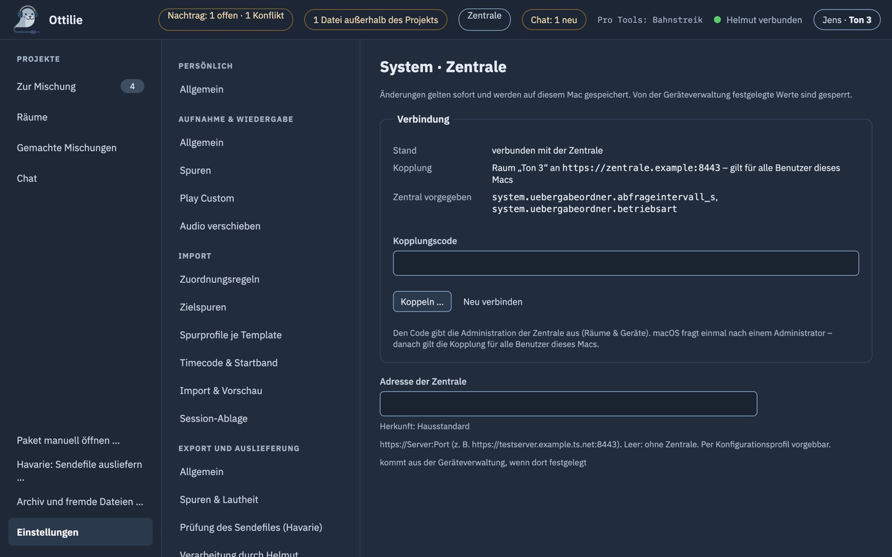

---

## Teil B – Web-App der Zentrale

Die Web-App ist für Plätze ohne Ottilie gedacht, vor allem Schnitträume. Sie zeigt den Raumstatus, die eigenen
Beiträge und den Chat. Sie läuft in jedem aktuellen Browser unter der Adresse der Zentrale, z. B.
`https://server:8443/`.

### B1. Koppeln

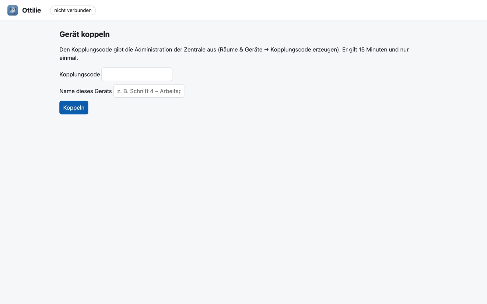

Beim ersten Öffnen fragt die Web-App nach dem **Kopplungscode** aus der Administration (6 Zeichen, 15 Minuten
gültig, nur einmal) und einem Namen für das Gerät, z. B. „Schnitt 4 – Arbeitsplatz“. Danach bleibt der Browser
gekoppelt. Anschließend fragt der Browser, ob er Benachrichtigungen zeigen darf. Mit „Erlauben“ kommen dringende
Nachrichten auch bei verdecktem Fenster an.

In Edge oder Chrome lässt sich die Web-App über das Symbol „App installieren“ in der Adresszeile als eigenes
Fenster einrichten.

### B2. Räume

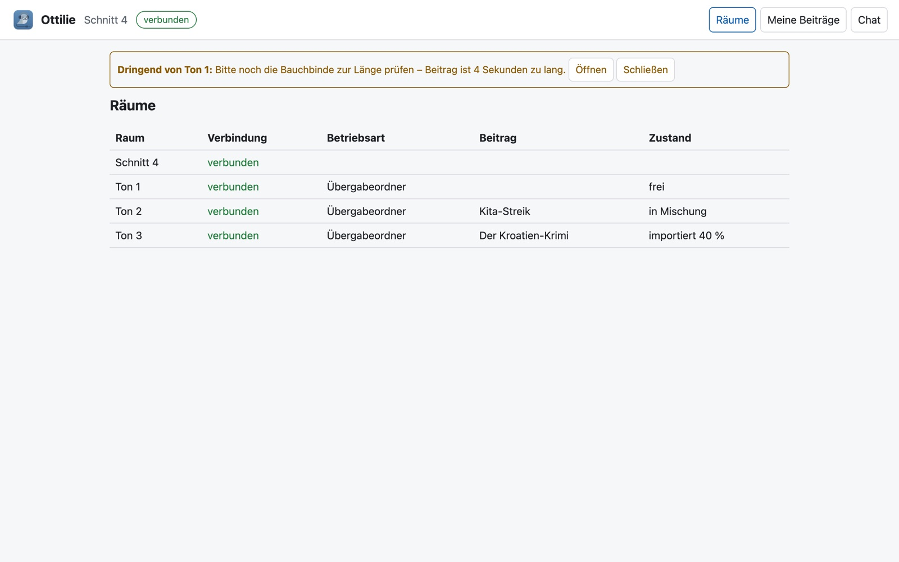

Alle Räume mit Verbindung, Betriebsart, Beitrag und Zustand. Oben rechts zeigt die Web-App, ob sie mit der
Zentrale verbunden ist.

### B3. Meine Beiträge

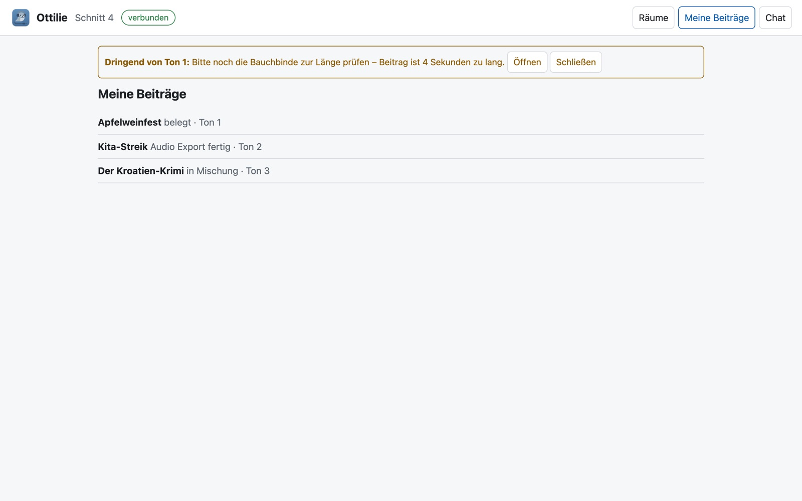

Die Beiträge, die aus diesem Raum übergeben wurden, mit dem aktuellen Schritt und dem Mischraum: übergeben →
belegt → in Mischung → Audio Export fertig. Das gibt es nur in der Betriebsart Übergabeordner.

**Übergeben** wird wie gewohnt: Filmordner in den Übergabeordner bzw. über Helmut. Die Web-App ist dafür nicht
nötig. **Neue Fassung, während schon gemischt wird:** Bitte im Beitragsgespräch Bescheid geben. Ottilie zeigt dem
Mischraum „neue Übergabe“, und er muss vor dem Zurückliefern bestätigen, dass es geklärt ist.

### B4. Chat

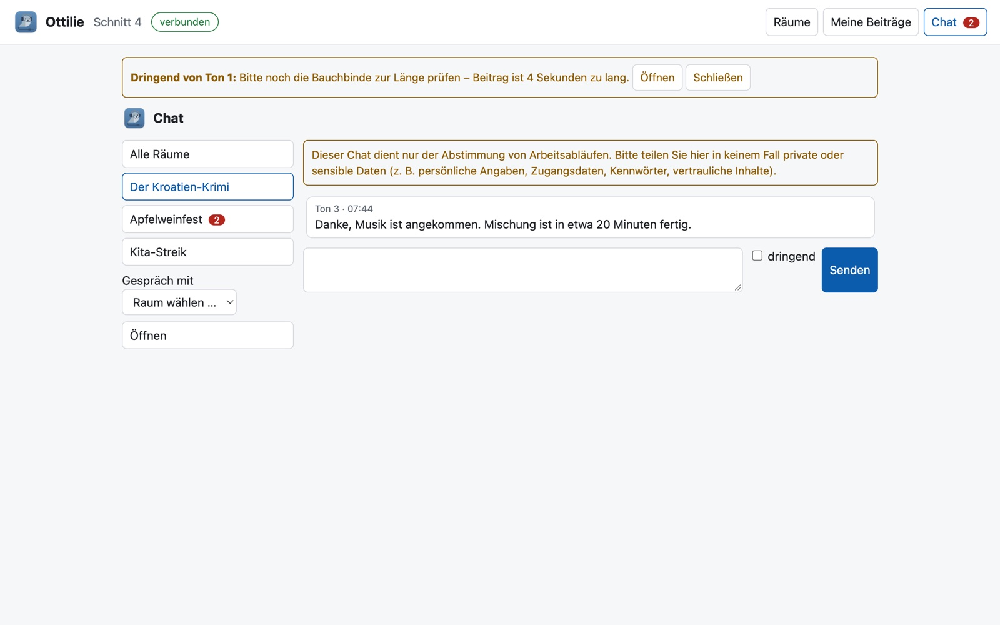

Bedienung wie in Ottilie ([A9](#a9-chat)): Gespräch links wählen, Nachricht schreiben, bei Bedarf *dringend*
anhaken, **Senden**. Systemmeldungen tragen das Ottilie-Logo. Eine dringende Nachricht erscheint oben als Hinweis
mit *Öffnen* und *Schließen*.

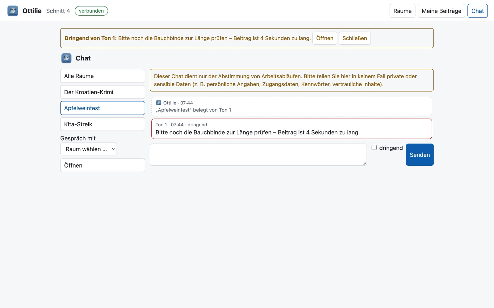

Auf dem Telefon oder Tablet ordnet sich die Seite untereinander an:

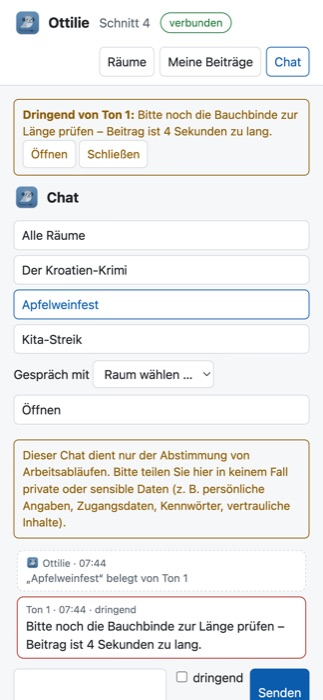

---

## Teil C – Administration der Zentrale

Die Administration erreichen Sie unter `https://server:8443/admin`. Oben steht die Navigation zu allen Seiten.
Eine Sitzung läuft nach der eingestellten Dauer ab (Standard 8 Stunden).

### C1. Anmelden und erstes Kennwort

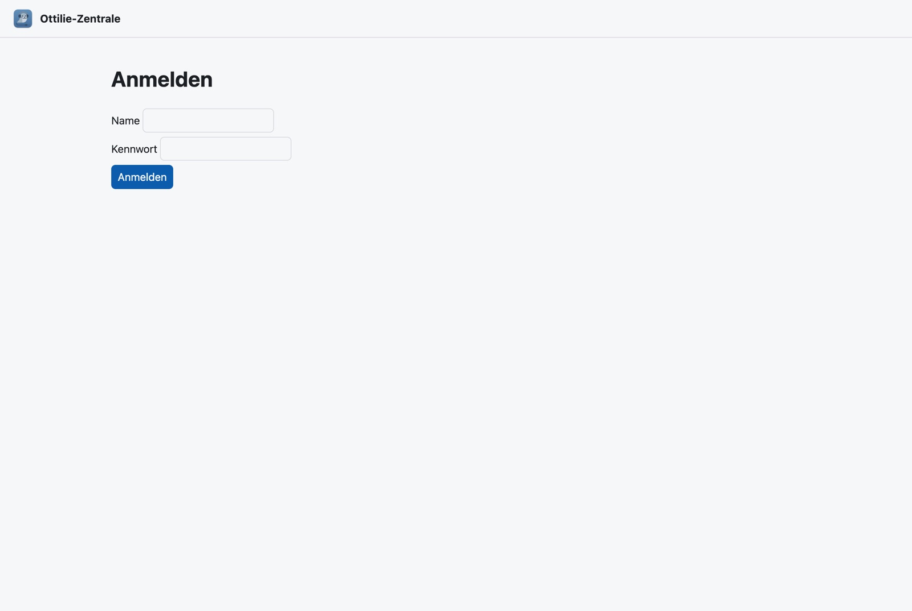

Beim allerersten Mal mit **admin / admin** anmelden. Danach verlangt die Zentrale sofort ein eigenes Kennwort mit
mindestens 10 Zeichen. Vorher ist keine andere Seite erreichbar. Nach 5 falschen Versuchen ist das Konto
5 Minuten gesperrt.

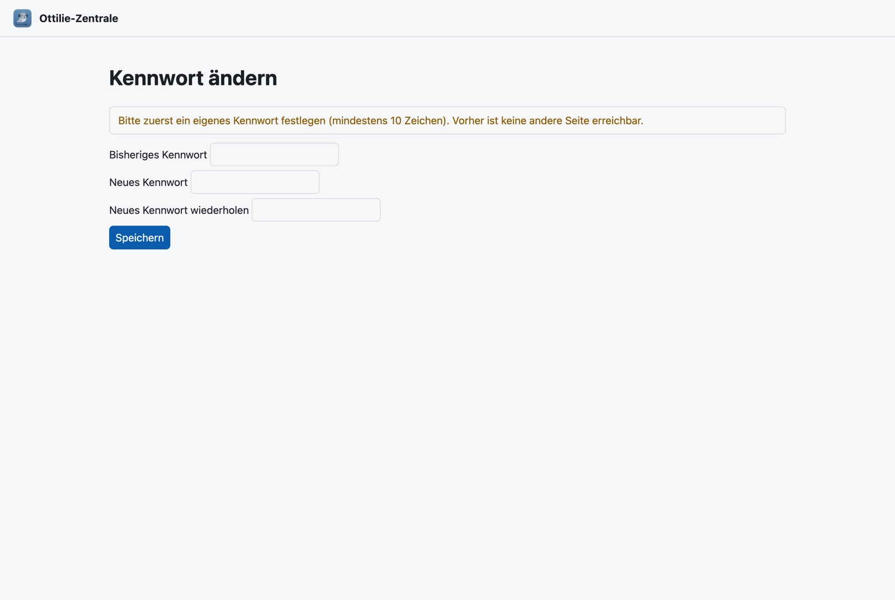

### C2. Übersicht

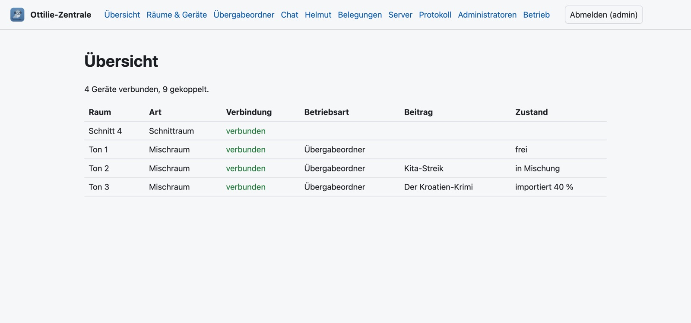

Alle Räume mit Art, Verbindung, Betriebsart, Beitrag und Zustand, darüber die Zahl der verbundenen und gekoppelten
Geräte.

### C3. Räume & Geräte

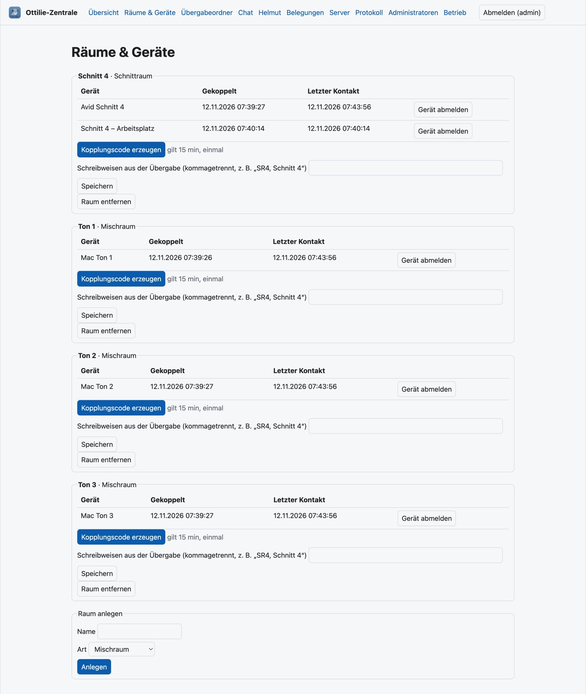

- **Raum anlegen** (unten): Name und Art. Die Art ist *Mischraum* (Ottilie, darf belegen), *Schnittraum*
  (Web-App, meldet Übergaben, bekommt „Meine Beiträge“) oder ein sonstiger Raum.
- **Wartende Geräte** (oben, nur wenn welche warten): Macs, die sich in Ottilie mit *Ohne Code anmelden …*
  gemeldet haben, mit Gerät, Kennung, Netzadresse und Zeitpunkt der Anmeldung.

  1. Der Raum ruft an und nennt den Code dieses Macs.
  2. Den Code mit der Spalte *Kennung* vergleichen.
  3. Raum wählen (Pflicht) und **Zuordnen** klicken. Der Mac verbindet sich neu und gehört sofort zum Raum.

  Passt der Code nicht oder ist der Mac unbekannt: **Ablehnen**. Bis zur Zuordnung sieht und sendet der Mac nichts.
  Anfragen verfallen 24 h nach dem letzten Kontakt; solange Ottilie läuft, verfallen sie nicht. Je Netzadresse
  warten höchstens zwei Macs, insgesamt höchstens 20. Jede Anmeldung steht mit Netzadresse im Protokoll.

- **Kopplungscode erzeugen** (zweiter Weg; die Web-App koppelt nur so): 6 Zeichen, 15 Minuten gültig, nur einmal
  einlösbar. In Ottilie unter Einstellungen → System → Zentrale eingeben, in der Web-App beim ersten Start.

  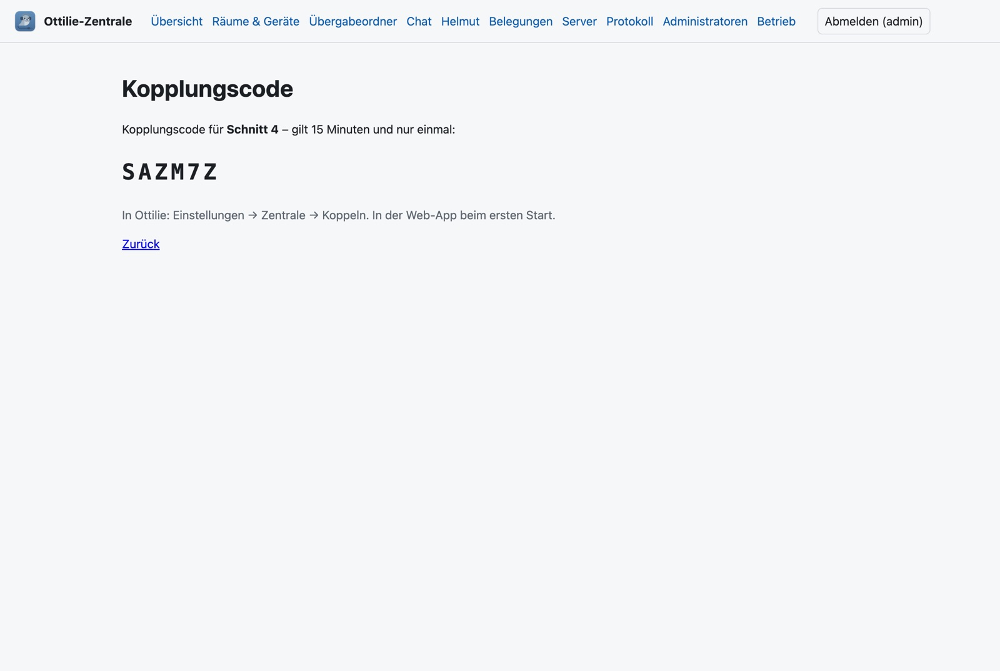

- **Umziehen** (je Gerät): neuen Raum wählen und **Umziehen** klicken. Der Mac muss nicht neu gekoppelt werden.
- **Umbenennen** (je Raum): neuen Namen eintragen und **Umbenennen** klicken. Belegungen, „Meine Beiträge“ und
  Chat ziehen mit; das Protokoll behält den alten Namen.

  Umziehen und Umbenennen gehen nur, wenn im Raum nichts in Arbeit ist (keine Belegung, kein Konflikt, Raum frei).
  Sonst lehnt die Zentrale mit Grund ab, z. B. „In Ton 3 ist noch etwas in Arbeit (…) – erst zurückliefern oder
  freigeben“. Ottilie übernimmt den neuen Namen erst, wenn auf dem Mac nichts mehr in Arbeit ist
  ([A7](#a7-räume)).

- **Schreibweisen aus der Übergabe:** Wie der Raum in Übergabe-Dateien oder bei Helmut heißt, z. B. „SR4,
  Schnitt 4“. So ordnet die Zentrale Beiträge dem richtigen Schnittraum zu.
- **Gerät abmelden:** Das Gerät verliert sofort den Zugang. Ottilie bietet dann *Neu anmelden …* an; danach steht
  der Mac wieder unter *Wartende Geräte*. Oder mit einem neuen Code koppeln. Die zentralen Vorgaben fallen in Ottilie
  erst weg, wenn dort gerade nichts in Arbeit ist.
- **Raum entfernen** nimmt den Raum mit seinen Geräten heraus. Belegungen des Raums bleiben bestehen; vorher unter
  *Belegungen* lösen.

### C4. Übergabeordner

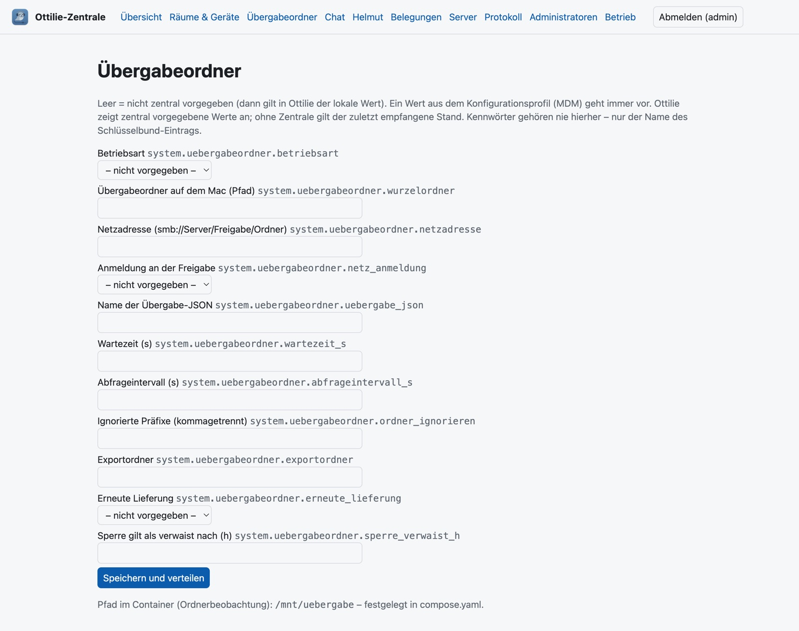

Hier geben Sie Werte für den Übergabeordner zentral vor: Betriebsart, Ordner, Netzadresse, Anmeldung an der
Freigabe, Wartezeiten, ignorierte Präfixe, Exportordner und mehr. **Speichern und verteilen** schickt sie sofort
an alle verbundenen Macs. Betriebsart und Übergabeordner wechseln dort erst, wenn nichts mehr in Arbeit ist.

- **Betriebsart:** gilt für alle Macs und ist in Ottilie gesperrt. Ohne Eintrag gilt die Helmut-API.
- **Leer** heißt bei den übrigen Werten: nicht zentral vorgegeben, in Ottilie gilt der lokale Wert.
- Ein Wert aus dem Konfigurationsprofil (MDM) geht immer vor.
- Kennwörter gehören nie hierher, nur der Name des Schlüsselbund-Eintrags.
- Ist ein Übergabeordner in den Container eingebunden, beobachtet die Zentrale ihn und meldet neue Beiträge sofort
  an alle Räume.
- Bei einem Fehler speichert die Zentrale nichts. Die Eingaben bleiben stehen, der Fehler steht am Feld.

**Mehrere Übergabeordner.** Im Feld *Weitere Übergabeordner* steht je Zeile ein Ordner:

`Name | smb://Server/Freigabe | gast oder kerberos | Pfad auf dem Mac`

- Netzadresse oder Pfad genügt. Anmeldung nur Gast oder Kerberos (ohne Angabe: Gast).
- Der Name ist zugleich die Kennung der Filme, z. B. „Schnitt Nord“ → `schnitt-nord/Film`. In Ottilie stehen alle
  Filme in einer Liste, mit „Ordner Schnitt Nord“ als Herkunft. Den ersten Übergabeordner benennt das Feld *Name des
  Übergabeordners*.
- Umbenennen oder Entfernen geht nur, wenn in dem Ordner nichts in Arbeit ist.
- Damit die Zentrale weitere Ordner beobachtet, bindet die Technik sie in `compose.yaml` ein: je Ordner ein eigener,
  nur lesender Eintrag unter `volumes` und dazu `ZENTRALE_UEBERGABE_WEITERE="Name=/pfad;Name=/pfad"`. Die Namen genau
  wie im Feld *Weitere Übergabeordner* schreiben. Das gilt ab dem nächsten Start des Containers. Einen Ordner, den
  die Zentrale nicht beobachtet, liest Ottilie selbst im normalen Takt.

### C5. Chat

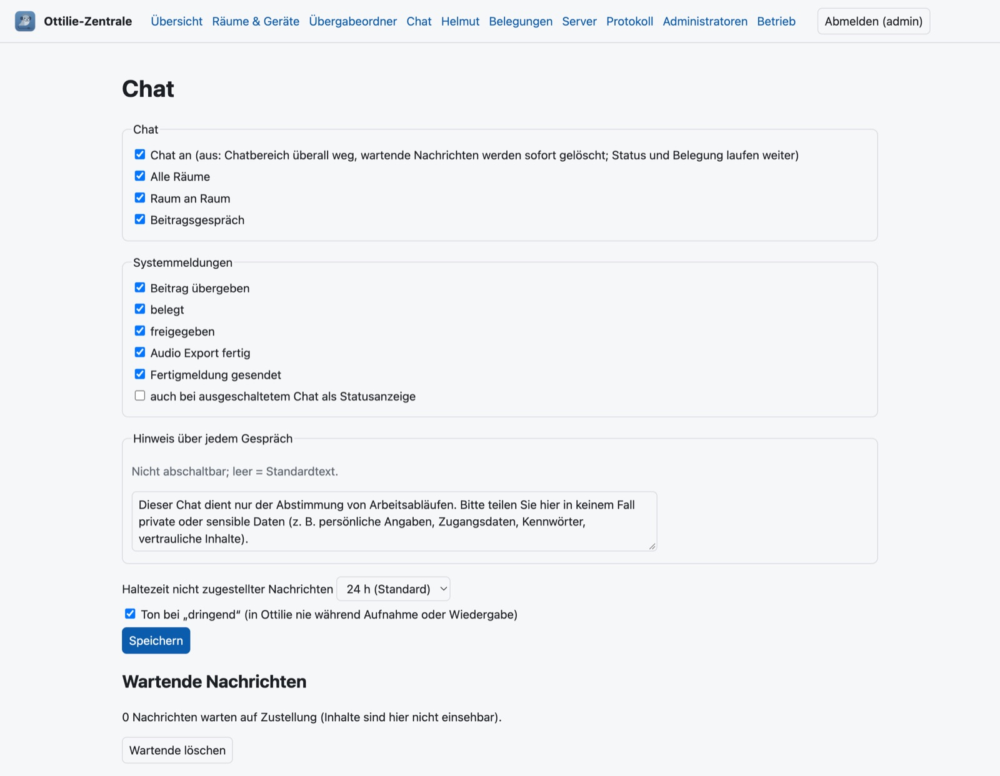

- **Chat an/aus:** Aus heißt, der Chatbereich verschwindet überall und wartende Nachrichten werden sofort
  gelöscht. Status und Belegen laufen weiter.
- **Gesprächsarten:** Alle Räume, Raum an Raum, Beitragsgespräch.
- **Systemmeldungen:** Welche Schritte im Beitragsgespräch erscheinen. Mit „auch bei ausgeschaltetem Chat“
  erscheinen sie trotzdem als Statusanzeige.
- **Hinweis über jedem Gespräch:** Nicht abschaltbar. Leer heißt Standardtext.
- **Haltezeit:** So lange wartet eine nicht zugestellte Nachricht höchstens (1 h bis 7 Tage, Standard 24 h).
- **Ton bei „dringend“:** In Ottilie nie während Aufnahme oder Wiedergabe.
- **Wartende Nachrichten:** Nur die Anzahl ist sichtbar, nie der Inhalt. *Wartende löschen* leert sie.

### C6. Helmut

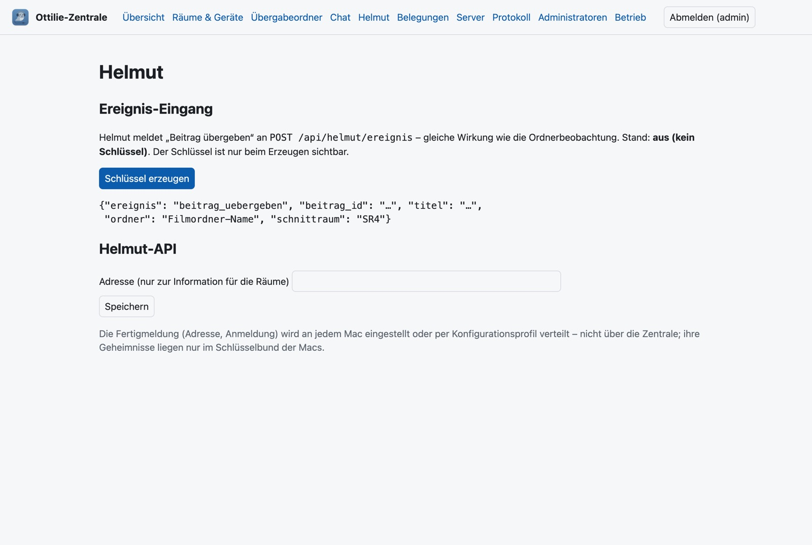

- **Ereignis-Eingang:** Helmut kann „Beitrag übergeben“ an die Zentrale melden. Das wirkt wie die
  Ordnerbeobachtung. *Schlüssel erzeugen* zeigt den Schlüssel nur dieses eine Mal; er gehört in die Konfiguration
  von Helmut.
- **Helmut-API:** Die Adresse steht hier nur zur Information für die Räume. Die Fertigmeldung und ihre Zugangsdaten
  werden an jedem Mac bzw. per Konfigurationsprofil eingestellt, nicht über die Zentrale.

### C7. Belegungen

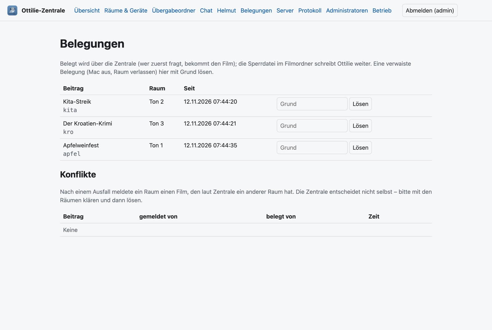

Welcher Raum welchen Beitrag belegt hat und seit wann. Bleibt ein Raum belegt, obwohl dort niemand mehr arbeitet
(Mac abgestürzt, Raum verlassen), löst **Lösen** mit Grund die Belegung. **Konflikte** entstehen nach einem
Ausfall, wenn ein Raum einen Film meldet, den laut Zentrale ein anderer Raum hat. Die Zentrale entscheidet das
nicht selbst: bitte mit den Räumen klären und dann lösen.

### C8. Server

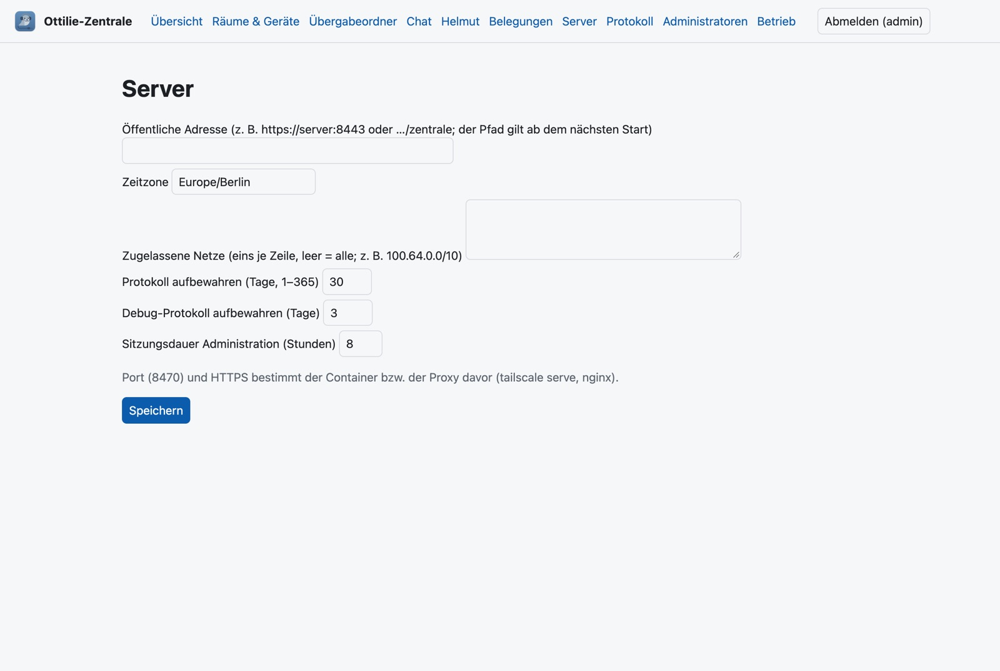

Öffentliche Adresse (bei Betrieb unter einem Unterpfad, z. B. `…/zentrale`, gilt sie ab dem nächsten Start),
Zeitzone, zugelassene Netze (leer = alle), Aufbewahrung des Protokolls, Sitzungsdauer der Administration. Port
und HTTPS bestimmt der Container bzw. der Proxy davor.

### C9. Protokoll

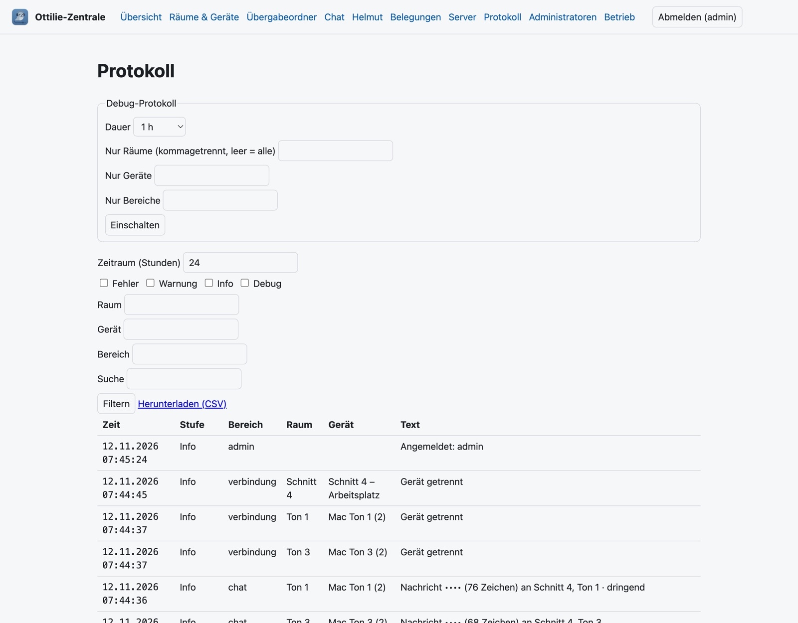

Alle Ereignisse mit Zeit, Stufe, Bereich, Raum und Gerät, filterbar und als CSV herunterladbar. Chattexte stehen
nie im Protokoll, nur Länge und Empfänger.

Das **Debug-Protokoll** schaltet sich nach der gewählten Dauer selbst ab und lässt sich auf Räume, Geräte und
Bereiche eingrenzen. Solange es läuft, zeigt jede Seite einen gelben Hinweis.

### C10. Administratoren

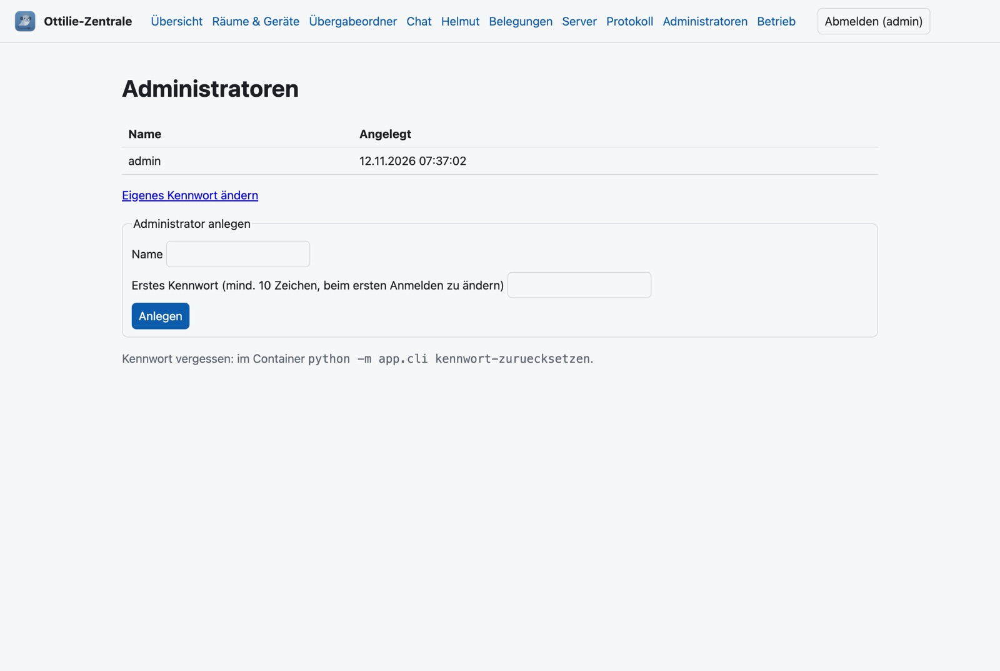

Weitere Administratoren anlegen. Das erste Kennwort muss beim ersten Anmelden geändert werden. Den eigenen Zugang
ändern Sie über *Eigenes Kennwort ändern*.

### C11. Betrieb: Sicherungen und Wiederherstellen

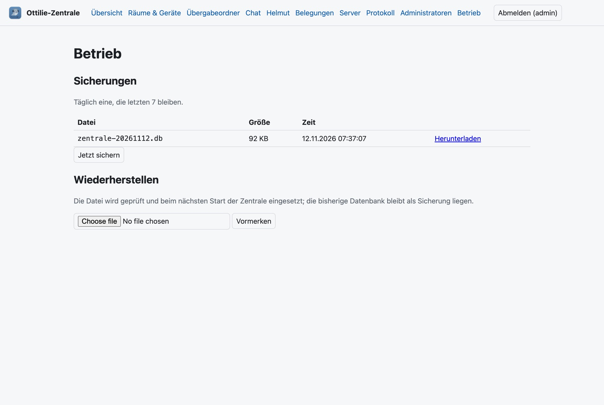

- Die Zentrale sichert ihre Datenbank täglich, die letzten 7 Tagessicherungen bleiben. *Jetzt sichern* legt
  sofort eine zusätzliche an; diese bleiben, bis sie jemand auf dem Server entfernt. *Herunterladen* holt eine
  Sicherung auf den Rechner.
- **Wiederherstellen:** Datei wählen, *Vormerken*, dann den Container neu starten. Die Zentrale prüft die Datei und
  setzt sie beim Start ein. Die bisherige Datenbank bleibt als Sicherung liegen. Geräte, die nach dem Datum der
  Sicherung gekoppelt oder zugeordnet wurden, müssen neu gekoppelt werden (in Ottilie *Neu anmelden …* oder
  Kopplungscode).
- Der Chat ist nie in den Sicherungen.

### C12. Befehle im Container (Notfall)

Wenn die Administration nicht erreichbar ist, helfen diese Befehle auf dem Server:

```bash
docker compose exec zentrale python -m app.cli kennwort-zuruecksetzen admin
```

```bash
docker compose exec zentrale python -m app.cli code "Ton 3"
```

```bash
docker compose exec zentrale python -m app.cli raeume
```

```bash
docker compose exec zentrale python -m app.cli sicherung
```

```bash
docker compose exec zentrale python -m app.cli oeffentliche-adresse-zuruecksetzen
```

Der letzte Befehl hilft, wenn nach dem Ändern der öffentlichen Adresse die Anmeldeseite nicht mehr erreichbar ist.
Danach den Container neu starten.

---

## Wenn etwas nicht geht

| Problem | Was tun |
|---|---|
| Titelleiste: Zentrale nicht erreichbar | Ottilie arbeitet mit dem letzten Raum weiter und verbindet sich selbst neu. Raumstatus, Chat und Belegen über die Zentrale gehen erst danach wieder. |
| Titelleiste: Mac wartet auf Zuordnung | Administration anrufen und den Code nennen, der in der Titelleiste und unter Einstellungen → System → Zentrale steht. Die Administration ordnet den Mac unter *Räume & Geräte → Wartende Geräte* zu ([C3](#c3-räume--geräte)). |
| Titelleiste: Mac noch nicht angemeldet / Zentrale kennt diesen Mac nicht mehr | Auf die Anzeige klicken, dann *Ohne Code anmelden …* bzw. *Neu anmelden …* (Administrator bestätigt). Danach Administration anrufen und Code nennen. Oder mit Kopplungscode koppeln. |
| „Von dieser Adresse warten schon Geräte“ | Höchstens zwei wartende Macs je Netzadresse. Administration bitten, die wartenden zuzuordnen oder abzulehnen, oder mit Kopplungscode koppeln. |
| Titelleiste: „Ton 3 → Ton 7 (nach dem Zurückliefern)“ | Die Administration hat den Mac umgezogen oder den Raum umbenannt. Zurückliefern oder freigeben und den Nachtrag leeren; dann übernimmt Ottilie den neuen Namen selbst ([A7](#a7-räume)). |
| Administration: Umziehen oder Umbenennen abgelehnt („… noch etwas in Arbeit“) | Im Raum erst zurückliefern oder freigeben bzw. die Belegung unter *Belegungen* lösen, dann erneut. |
| Pro Tools reagiert nicht, Ottilie meldet ein Zeitlimit | Meist ist in Pro Tools ein Dialog offen. Dialog schließen, dann den Auftrag neu starten. |
| Holen oder Zurückliefern bricht mitten im Ablauf ab | Ottilie zeigt, an welchem Schritt es hing. Ursache beheben und neu starten. Gelöscht oder überschrieben wird dabei nichts; eine erneute Lieferung schiebt die vorige beiseite. |
| Helmut weg, die Sendung drängt | Havarie: Sendefile ausliefern ([A11](#a11-havarie)). |
| „schon in Ton 1 belegt“ / „bereits übernommen von …“ | Ein anderer Raum war schneller. Im Chat oder unter *Räume* klären. |
| Raum bleibt belegt, obwohl niemand dort arbeitet | In Ottilie unter *Räume* → *Beitrag zurückgeben …*; in der Betriebsart Übergabeordner zusätzlich in der Administration unter *Belegungen* → *Lösen*. |
| Übergabeordner nicht erreichbar | Netzwerk und Freigabe prüfen. Mit Netzadresse bindet Ottilie die Freigabe selbst wieder ein. |
| Hinweis über der Liste: „Übergabeordner nicht erreichbar: Schnitt Nord“ | Netzwerk und Freigabe dieses Ordners prüfen. Ottilie versucht es selbst weiter. Filme aus den anderen Ordnern gehen; die Filme dieses Ordners erst, wenn er wieder da ist. |
| Fertigmeldung nicht angekommen | Steht im Nachtrag und wird wiederholt. *Jetzt nachtragen* versucht es sofort. |
| Nachtrag wartet auf einen anderen Benutzer | Der Eintrag stammt von einem anderen macOS-Benutzer dieses Macs. *Jetzt nachtragen* trägt ihn mit nach. Nennt er danach einen Grund („… nachtragen kann …“), diesen Benutzer bitten, sich am Mac anzumelden und *Jetzt nachtragen* zu wählen ([A10](#a10-nachtrag)). |
| Mitteilung: gemeinsamer Datenordner nicht nutzbar | Technik prüft die Rechte von `/Users/Shared/Ottilie`. Bis dahin gelten Nachtrag, Gemachte Mischungen und Havarie-Pakete nur für den angemeldeten Benutzer. |
| Technik braucht Angaben zum Mac | Ottilie-Symbol in der Menüleiste → *Diagnosebericht erstellen*. Die Datei `Ottilie_Diagnose_….txt` liegt auf dem Schreibtisch. Der Abschnitt „Zentrale und gemeinsamer Datenordner“ nennt Kopplung, Code dieses Macs, Datenordner und zuletzt bekannten Raum. |
| Admin-Kennwort vergessen | Befehl `kennwort-zuruecksetzen` (siehe [C12](#c12-befehle-im-container-notfall)). |
| Mac neu anmelden | In Ottilie *Neu anmelden …*, Administrator bestätigt, Administration ordnet zu. Oder in der Administration einen neuen Code erzeugen und in Ottilie eingeben. |
